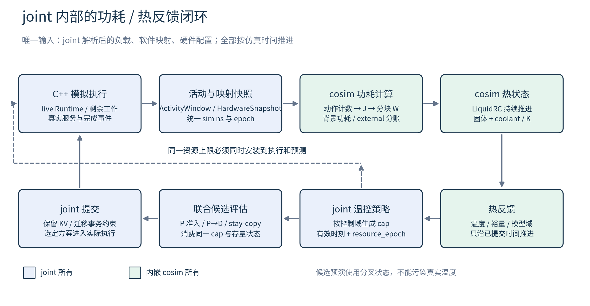

# thermal/cosim 内嵌 template/joint 执行方案

版本：1.0 · 研究日期：2026-10-20（Asia/Shanghai）  
代码基线：`788e1abf8496d86d07821c9d1eac197141c631a1`  
源组件：`wafer-thermal-cosim/`  
目标组件：`template/astra-sim-joint/`  
本轮交付：代码研究后的实施设计文档；文中的新增目录、接口、配置和测试均为拟实现内容，不代表集成已经完成。

## 1. 方案结论与最终交付边界

将 cosim 的 Python 热核心、能量模型和必要配置作为 joint 内部依赖，放进 `template/astra-sim-joint/extern/thermal_cosim/`。由 joint 的 Python online service 持有一个持续存活的 cosim 实例；通过现有 Python/C++ 在线桥的扩展，把功耗、温度和降额状态纳入同一条仿真事件时间轴。在线 RC 后端不另起 thermal 调度器，也不在每次候选评估时启动 CLI 子进程。

实现后的职责必须保持如下关系：

> joint 提供负载与实际执行活动、软件映射、已解析硬件配置；内嵌 cosim 将这些输入转为功耗和热反馈；joint 根据热反馈决定降频与联合调度，并让同一降频状态同时作用于成本预测和真实模拟执行。下一段实际活动再反馈给 cosim。

这里的“负载输入”既包括请求/算子工作量，也包括已执行区间的活动计数。只有模型总 FLOPs 和映射，无法唯一确定区间功率；同一任务在不同并发、等待、迁移和频率下，单位时间活动不同。需要从 joint 导出这些执行事实，但不能让 cosim 再维护一套 request 队列、KV 账本或任务执行器。

最终验收以 **closed_loop 模式在 joint 内部完整运行** 为准，包括实际执行速度变化、下一轮联合选择变化以及能量/温度账本可回放。仅完成文件搬迁、温度日志、离线回放，或只修改候选成本，均不能算完成集成。



本方案分为两层验收：

- 工程闭环：输入来源唯一、计数正确、事件因果正确、降额真实生效、预测与执行一致。
- 模型可信度：目标硬件能量系数和物理热参数达到规定精度。现有 RC 候选的精度 gate 已标记 failed，不能用工程测试通过替代这项验收。

## 2. 仓库现状：哪些可以复用，哪些必须新增

### 2.1 thermal/cosim 侧

`wafercosim` 已是 Python 包，要求 Python ≥3.10，活动运行依赖 NumPy/SciPy。`LiquidRC` 接受每个热块的 W 向量和秒数，持续推进内部固体/冷却液状态；当前没有 workload/rank 适配、累计仿真时钟、快照、候选预演或 joint 闭环。`README.md` 和 `docs/research_platform.md` 也将 joint 接线列为后续工作。[E01–E05]

现有配置为 schema v2，明确拒绝 workload、执行模型和旧 throttle/resume 等字段。这条约束应保留：热模型只描述几何、材料和冷却，不能把 joint 的调度职责迁回 thermal 配置。[E02]

`EnergyModel` 已有动作计数到 J、背景项到 W 的查询接口，并能验证 host 提供的硬件事实。但它没有按 rank/die/block 归集的功率窗口，没有电压/频率输入，也没有自动完成 DVFS 后的工作量重估。[E06–E08]

参考几何是 4×2 个 die，每 die 有 2×2 个 compute 热块及 HBM/router 两个块，共 48 个固体功率槽位；这不是 joint 目标硬件的默认 floorplan。`die_max()` 取每个 thermal die 内所有模型热块等效温度的最大值，不再对这些块做平均，也不能称为实际 Core/求解器 cell 级热点。[E03、E04、E09]

### 2.2 joint 侧

joint 的在线联合调度包含请求准入和 P→D 边界决策，候选代价通过执行图投影评估，业务提交另外执行。候选评估虽然不应提交 KV/迁移事务，仍存在缓存和诊断计数等副作用；新增热预演必须专门隔离物理状态，不能泛称整个评估函数完全无副作用。

外层 `joint_runner.py` 负责启动内层 runner；在线工作发生在内层 C++ 模拟器与 Python service 的 FIFO/POSIX shared-memory 交互中。因此应把热实例放在 online service 的生命周期内，不能在外层 runner 只运行一次 thermal 后把结果当闭环。

coarse die 底层已有按给定仿真时间更新绝对物理服务率的能力，但生产在线封装和跨进程控制面尚未接通。预测侧的预排 `coarse_capacity_events` 也不等于在线能追加容量变更。实施必须同时改生产执行封装、事件重排和预测输入。[J01–J09]

### 2.3 当前缺口一览

| 链路 | 当前能力 | 本次实施需要补齐 |
|---|---|---|
| 硬件输入 | joint 有运行硬件；cosim 能检查 host facts | 从解析后硬件导出唯一 snapshot，并绑定几何/能量域 |
| 负载/活动 | joint 有请求、执行图和资源服务过程 | 带时间戳、源身份和计量单位的增量活动窗口 |
| 功耗 | 动作 J、背景 W 查询可用 | 活动归集、空间投影、区间 W、外部能耗分账 |
| 热推进 | RC 持续状态、变长正 dt | 仿真时间对齐、快照、重放、强化有效值校验 |
| 控制 | thermal 不含调度器 | joint 侧温控策略，产生域级降额状态 |
| 实际执行 | coarse 底层可变资源率 | online 安装降额、剩余工作积分和完成事件失效 |
| 联合决策 | 原有成本/候选流程 | 同一降额状态进入所有相关成本路径和缓存键 |
| 发布 | 独立 thermal 源树 | joint 内可安装、可构建、无兄弟目录依赖 |

## 3. 所有权与输入原则

### 3.1 明确分工

| 对象 | 唯一拥有者 | 其他组件可以做什么 |
|---|---|---|
| request、P/D 阶段、KV、迁移/驱逐、候选提交 | joint scheduler / ledger | cosim 只读稳定身份与活动，不做事务 |
| 仿真时钟、任务进度、通信完成、资源占用 | joint 执行引擎 | cosim 消费已提交区间，不自行推进任务 |
| peak 硬件、Core/Die/网络/内存组织 | joint 已解析硬件 snapshot | cosim 验证支持域，不能用表内参考值覆盖 |
| 物理热几何、材料、冷却 | cosim 的 thermal profile | 用明确映射绑定 joint die，不反推执行拓扑 |
| 动作能量、背景功率、功率投影 | 内嵌 cosim 库 | joint 提供计数、映射、硬件与运行点 |
| 固体/冷却液温度及热能量账本 | cosim 热会话 | joint 获取不可变反馈和可分叉快照 |
| 温度阈值、频率档位、滞回和恢复规则 | joint 的 thermal policy | cosim 只返回温度、模型域和诊断 |
| 最终资源速率和实施时刻 | joint runtime | 决策预测读取同一版本的降额状态 |

joint 适配层只做身份/时间/活动对接，不再复制一份能量公式。将 `ActivityWindow + MappingSnapshot + HardwareSnapshot + OperatingPoint` 变成 `PowerWindow` 的逻辑放进内嵌 cosim 组件，这样 thermal 仍然承担用户要求的“根据负载、映射和硬件提供功耗”。

### 3.2 三种网格必须分开

1. Astra rank/网络拓扑，描述参与者及连接；包含哪些物理对象由解析后配置确定。
2. 每 die 的 Core 网格，描述计算资源组织与工作映射。
3. thermal block/floorplan 网格，描述热源矩形、材料和冷却路径。

禁止把 rank 编号直接当 thermal block 下标，也禁止用 thermal 的 4×2 或 2×2 网格推断执行硬件。一个热块可覆盖多个 Core；此时反馈精度就是聚合热块精度，不能凭空恢复逐 Core 温度。没有显式物理映射时，closed_loop 初始化应失败并指出缺失字段。

## 4. 内嵌目录、安装与源码迁移

推荐保留 `wafercosim` 包名以降低迁移风险，由 joint 固定其源码版本。拟议布局如下，树中的新增文件均需在实施阶段创建：

```text
template/astra-sim-joint/
  extern/thermal_cosim/
    pyproject.toml
    wafercosim/
      thermal.py, action_energy.py, config.py, backends.py
      contracts.py          # 新增：稳定数据契约
      session.py            # 新增：功率/热会话和状态生命周期
      power.py              # 新增：活动→J/W、空间归集
    configs/thermal/        # 明确标识的参考输入、目标 profile
    configs/energy/         # 有 provenance 和支持域的校准表
    tests/
    LICENSE, THIRD_PARTY.md, SOURCE_MANIFEST.json
    reference/             # 可选 native 桥和构建入口
  sh_test_mesh/workload/llama2_7b_inference/
    joint/thermal_bridge.py
    joint/thermal_policy.py
    joint/thermal_cost.py
  sh_test_mesh/run_scripts/thermal_replay.py
  docs/thermal_cosim/       # 使用说明、契约、验收结果
```

迁移策略采用受版本控制的 vendored 内部依赖：首次迁入保留许可证、源 commit、文件清单、文件 hash 和必要来源说明；后续通过显式同步变更维护。不要仅建立指向 `../../wafer-thermal-cosim` 的软链接或用绝对 `PYTHONPATH` 绕过安装，那会让 joint 无法独立分发。

运行安装提供 joint 内入口，例如实施后支持：

```bash
# 拟新增/整理的安装约定；路径以 joint 根目录为基准。
python -m pip install -e ./extern/thermal_cosim
```

配置文件需要作为 package data 安装，或由 joint 使用明确配置路径定位；不能依赖调用者当前目录。默认在线 RC 不要求编译 HotSpot/3D-ICE。Timeloop、BookSim、DRAMSim3、Accelergy、ATLAS、MFIT 等保留为离线校准来源，不打进每次在线运行的必要依赖。[E10]

对于参考后端，保留所需 native bridge、锁定版本和可重复构建指引；上游源码可以放在单独 reference 目录或由锁文件获取。迁移前逐项检查原始许可，必须保留的 notices 与分发义务不能只用原仓总 LICENSE 替代。当前源目录可暂留兼容包装，但最终 standalone joint 检查须在不提供兄弟 cosim 目录的情况下通过。

## 5. 拟新增的数据契约

以下均为设计接口；现有 `LiquidRC.step(power_w, dt_s)` 和 `EnergyModel` 查询仍保留为底层实现。

### 5.1 HardwareSnapshot 与 MappingSnapshot

`HardwareSnapshot` 在 joint 完成配置解析后生成，包含 `schema_version`、内容 hash、配置来源、物理源清单、资源域和单位。核心字段：die/Core 组织、各资源峰值、时钟峰值、精度、SRAM 总容量/宏组织、HBM/DRAM 组织与通道、NoC/D2D 连接/位宽及其性能模型口径。

`MappingSnapshot` 包含 `mapping_epoch`、rank→物理对象、Core group→thermal block、HBM channel→HBM block、link/router→发热块、外置 DRAM→external sink 的映射。工作映射中还应保留 request/phase/operator→执行资源的关联，便于审计，不要求 thermal 理解 KV 策略。

映射的能量分配权重对每个物理源应满足非负且和为 1；不在热网格内的能量显式进入 external。若源身份缺失，禁止平均摊到所有 die 并把结果标作精确物理映射。

### 5.2 ActivityWindow

| 字段 | 语义与约束 |
|---|---|
| `run_id, activity_seq` | 运行身份与单调序号，用于去重/回放 |
| `start_ns, end_ns` | 整数仿真 ns；半开区间 `[start,end)`；end > start |
| `hardware_hash, mapping_epoch` | 区间实际使用的硬件/映射版本 |
| `resource_epoch` | 实际应用的频率/资源速率版本 |
| `source_id, action_kind, count` | 按物理源累计的动作数；单位依 action schema 固定 |
| `source_id, active_ns, idle_ns` | 驻留/门控状态时长，避免等待时误算动态运算 |
| `operating_points` | 本区间运行点；区间内变化必须分段 |
| `coverage, provenance` | 计数来自真实服务、执行图估计或显式假设 |

初始支持的语义包括 PE/Vec 有效 op、SRAM 读写 byte、HBM/外置 DRAM 读写 byte、NoC link byte、D2D/DRAM IO byte，以及有明确定义的 control action。具体 action 名称与现有 `action_energy.py` 对齐；未建模的 action 必须有显式覆盖报告，不能默认为零。

不能同时把一次 HBM 传输按“模型总 bytes”和“执行服务 bytes”各计一次。NoC 若能量系数以每 hop byte 定义，必须累计 link-byte；若系数已包含路径则不能再乘 hop。计数口径要写进动作注册表并由单元测试验证。

### 5.3 PowerWindow

`PowerWindow` 包含相同时间/身份版本、与热模型 block 顺序一一对应的 `power_w[]`、分动作/分块动态 J、背景 J、external J、总能量和覆盖诊断。块 ID 使用稳定标识，不把内部数组下标当持久 ID。

```python
# 设计草图；不是仓内已经存在的 API。
power = session.estimate_power(activity, mapping, hardware, operating_point)
feedback = session.advance_committed(power)
view = session.snapshot()
trial = session.fork(view)       # 仅对有能力的 RC 后端开放
```

`advance_committed()` 必须要求 `power.start_ns == committed_time_ns`，拒绝重叠、倒退和未经解释的空洞；空闲时间也由显式零活动窗口推进背景功耗。重复相同序号的提交应返回已提交结果或明确报重复，不能把热量再积分一次。

### 5.4 ThermalFeedback 与 ResourceEnvelope

`ThermalFeedback` 由 cosim 返回：热 epoch、有效仿真时间、block K、可用的 coolant K、die block-max K、能量残差、模型/校准身份和有效域状态。它不包含 placement 选择或 KV 迁移命令。

joint 的 thermal policy 将反馈转为 `ResourceEnvelope`：每个控制域的当前档位、资源上限、`effective_from_ns`、有效 epoch、原因和温度裕量。有效能力由硬件峰值、其他资源约束、热上限共同限制，不能通过恢复温度把其他限额冲掉。

单位统一为：仿真时间 ns，热 API 时间 s，频率 Hz，吞吐 op/s 或 byte/s，动作数 op/byte，能量 J，功率 W，温度 K，几何 m。只在热调用边界做 `dt_s = (end_ns-start_ns) * 1e-9`；宿主 `perf_counter_ns` 仅用于开销统计。

## 6. 从活动生成真实功耗

### 6.1 动态项、背景项和空间投影

对热块 b、区间长度 Δt，采用以下账本：

```text
E_dynamic[b] = Σ(action a, source s) weight[s,b] × energy(a, count[s,a], T[s])
E_background[b] = ∫ background_power(b, T(t), power_state(t)) dt
P[b] = (E_dynamic[b] + E_background[b]) / Δt
E_system = Σ_b P[b] × Δt + E_external
```

现有 EnergyModel 没有 V/f 参数，第一版可以采用显式声明的固定电压、仅降频模型：每动作能量按现有校准域计算，降低频率后实际区间完成的动作减少；漏电按温度和真实时间累计。不要在没有电压表时套 `P∝f³`，也不要在已减少动作数后再次把动态能量乘频率比。

后续若引入 DVFS 电压档位，需要增加有来源的 `OperatingPoint` 校准和 table domain；动态能量、背景漏电、执行吞吐都要一致使用该档位。不能把这一扩展描述为当前 EnergyModel 已支持。

### 6.2 计数来源的实施顺序

优先从 coarse 运行时“实际已服务的资源工作量”产生增量计数，能够正确处理未完成任务、等待、重叠、抢占和分段降额。现有 `query_progress_at/counters_at/sample_snapshot_at` 已能在 Runtime 副本上采样，包含逐活动 planned/served work、HBM R/W 与 INT4/Vec 服务量；它们是可复用原料，当前尚未形成在线热窗口。对周期服务量和物理动作数建立显式换算，保证 op 和 cycle 口径不混用。[J07、J10]

执行图可用于预测候选功耗，也可在缺少细粒度实际计数时作为已标记的初期估计；但不能在一个跨多个热窗的算子开始时，把全部算子能量一次注入，结束时又重复注入。最低要求是按真实服务进度分段归集，并记录哪些动作仍是估计值。

HBM、NoC、D2D 和外置内存的活动应由对应资源/传输路径提供，不能用总耗时乘统一利用率代替全部来源。外置 DRAM cell/background 能耗记到 external；片上 IO 若映射到 router/IO lump，则按现有 destination 规则归属。[E07]

### 6.3 温度依赖与窗口误差

默认使用窗口起点温度估计温度相关能量，属于显式一阶耦合；通过减半热步验证误差。若需要迭代预测，应在分叉状态上迭代，最后只向 committed 状态提交一次。表的温度范围、硬件域越界必须报告；closed_loop 不允许捕获异常后继续把未经标记的功率当已校准结果。

## 7. 热会话与状态隔离

为 RC 新增 `snapshot/fork/reset/close` 和累计 `committed_time_ns`。快照至少包含固体与 coolant 温度、累计输入/移除能量、残差、模型/映射 hash、时间戳和状态版本。不能只复制返回的固体温度，因为 coolant 状态会影响后续结果；也不能仅给 `T` 赋值却保留旧能量账本。

不变几何、稀疏矩阵结构可以共享；可变温度、账本和候选诊断分开。LU 缓存是性能缓存，不是物理状态；现有 dt cache 用 `round(dt,12)`，实施时需要给允许 dt、舍入误差和缓存上限明确规则，不能将任意 ns 分段悄悄合并成错误时间步。[E03]

每个候选只能从同一个已提交快照出发预演；丢弃候选不得更改 committed 温度、累计能量或时间。状态版本不符时拒绝提交旧预测。热模型输入检查强化到有限正 dt、有限非负 W、有限物性参数与可解析 identity，覆盖当前仅检查 `dt <= 0` 的缺口。

在线第一后端固定为 RC。3D-ICE 使用固定步长且无原生快照，HotSpot/3D-ICE 状态在持久子进程内；不能伪装成可随意 fork 的候选后端。对它们提供 capability 标志并用于选定轨迹重放/校准。3D-ICE 回放必须先将窗口按合法固定 dt 重新归集并验证能量守恒，禁止直接把变长窗塞入固定步长接口。[E11]

## 8. 统一仿真时间与闭环时序

### 8.1 明确采用离散热反馈

在物理时间 tₖ 已提交所有旧区间活动后，计算 Tₖ 并得出 capₖ；capₖ 从 tₖ 起作用于后续执行。Tₖ₊₁ 使用 `[tₖ,tₖ₊₁)` 内实际发生的活动计算，不回头修改已执行区间。

```text
真实执行 [tₖ₋₁,tₖ) / 旧 cap
        ↓ 到达全局 thermal barrier tₖ，停止向前执行
收齐所有参与源截至 tₖ 的活动、映射版本和剩余工作
        ↓ cosim 生成旧区间功率并推进到 Tₖ
joint policy 计算新 capₖ / resource_epoch
        ↓ 安装同一资源版本到真实执行与成本预测
处理 tₖ 上的准入、P→D 或其他待决策事件
        ↓ 提交被选方案，恢复执行直到下一个 barrier
```

热反馈采样存在一个热步的检测延迟，这属于该离散模型的公开语义。不能声称区间末发现的超温已在区间内部自动限频。通过窗口收敛与最大超温量验收评估延迟；必要时用更短热步或预测安全裕量，不能借回写历史消除问题。

### 8.2 必须新增执行端 thermal barrier

当前 bridge 主要为请求/边界决策提供在线交互，不保证长算子执行期间或无人请求时仍定期调用 Python。完整闭环必须新增 C++ 仿真事件 `THERMAL_EPOCH`，按仿真时间触发，在无新请求但仍有计算/迁移/通信时继续运行。

对共享同一热网络的多个 rank/实例，使用共同 watermark：只有全部参与源都确认截止 tₖ 的活动，才能推进全局热状态。任何参与者不得先执行到 tₖ 之后再来使用新的 tₖ cap。须以现有事件引擎/分布式运行方式实现实际 barrier，不能仅在 Python 收集时比较时间戳。

现有 `sample_snapshot_at()` 要求采样 tick 等于 `Sys::boostedTick()`，并且不处于终态 callback 分派中；它只推进私有 Runtime 副本。因此 barrier 应安排在同 tick 的旧完成/终态 callback 分派结束后采样，不能从 Python 任意传一个未来时间直接查询 live 系统。[J07]

若现有跨进程接口无法在非请求事件上安全握手，需要新增 epoch 消息路径。禁止在 C++ 已阻塞等待 Python 请求响应的同时，又让 Python 反向等待 C++ 发一个永远不会发出的热事件。

### 8.3 同时刻顺序与控制消息

规定 tₖ 上统一顺序：完成旧区间资源积分和完成事件归账 → 截止活动计数 → 推进热状态 → 安装新资源上限 → 处理此刻调度/新工作。区间内映射或运行点变化时，在相应时刻分段；热反馈仅在明确策略边界更新。

在两个热采样边界之间到达的决策，读取最近一次已提交温度和仍有效的 cap，同时记录温度的 `as_of_ns`；执行进度快照则必须取本次决策 tick。不能把旧温度标成当前瞬时温度，也不因多评估一个候选而额外推进真实热状态。第一版使用固定名义热步，允许活动/映射边界细分；采样步长通过收敛试验确定，不直接沿用参考输入的10 ms。

拟扩展协议包含：`schema_version`、`message_kind`、`run_id`、`thermal_epoch`、`effective_ns`、`hardware_hash`、`mapping_epoch`、`resource_epoch`、payload 长度和状态码。若共享内存是固定布局，C++/Python 必须一起升级并握手验证；不能直接追加 JSON 字段而忽略另一侧的容量/解析约束。

本轮设计不强行假设现有字段可直接复用。新增 `ACTIVITY_EPOCH` / `THERMAL_CAP` 或同等消息后，必须测试旧协议拒绝、新协议匹配、payload 上限、重复/乱序、半写、超时和退出清理。

推荐给热控制一段独立、顺序执行的握手：C++发送活动截止帧→Python返回cap→C++校验并安装全部域→返回CAP_ACK/状态，再进入同tick的普通决策帧。按原有一帧在途的约束实现，不在请求响应内部嵌套反向RPC。只有已确认安装的 `resource_epoch` 才能作为真实有效版本；若选择把cap和GraphBatch合在同一回复，则必须实现“先验证全部、先安装cap、再提交图”的等价原子语义及明确ack，不能留下半个系统已降额的状态。

模型/协议/域更新失败时，默认中止本次closed_loop运行并保存最后一致时间与错误，不自动退成off后仍报告闭环成功。物理时间已经推进到t的热状态不因未来cap安装失败而随意回滚；修复后从完整一致checkpoint或从输入轨迹重放。

### 8.4 空闲与结束条件

系统空闲但硬件仍上电时，使用零动态活动加背景功率推进温度；冷却和恢复滞回仍可发生。所有请求结束后，若还有 in-flight 迁移/通信继续计入。全系统工作真正耗尽后，按运行配置结束；可选冷却观测阶段必须有明确终止时间，不能因为循环热事件使仿真永不退出。

## 9. 温控策略与真实执行降额

### 9.1 策略归 joint

joint 侧配置每个物理控制域的阈值、频率档位/最低档、恢复滞回、最短驻留时间和采样步长；这些字段放在 joint policy 配置，不塞回 thermal schema。数值必须标明来源，文档不把参考 300 K 初温或任意阈值当作目标器件规格。

默认第一阶段使用现有 `COMPUTE_GATE`，控制 coarse compute-stage 的归一化吞吐。该 gate 峰值是 `1.0 second_of_service/s`；Mapping 把 PE/Vec 工作分别按峰值和效率换成秒后相加，并将 `compute_s` 记入 gate work。当前没有独立 PE/Vec 资源速率控制项。[J04、J05]

policy 输出 `compute_throughput_fraction`，按控制域和固定电压频率模型映射为 gate 的绝对 rate；若用 `f/f_base` 近似该 fraction，必须在 manifest 标识近似模型。它是执行中的 compute-stage 降额，不是已经具备电压、逐 PE/Vec OPP 或精细时序的完整 DVFS 模型。若研究要求这些能力，需另扩 plan/resource schema 和校准，不能伪称现有模型足够。

HBM、NoC、D2D、pool 的温度可反馈、其能耗必须覆盖；若要改变带宽，分别接对应控制域和执行模型，不能把所有资源乘同一个 f 比例。多 die 共享时钟/供电域时，对域内所有受影响 die 一起更新。

策略输出为有上限的资源 envelope，恢复时也受不可变硬件峰值和其他限额限制。安全关断或无可执行档位时，需要定义暂停/终止行为并在调度器显式处理，禁止把 rate=0 填入不支持零速率的求解器制造除零。

### 9.2 底层 capacity API 只是接线基础

在有效时间 t 更新资源速率前，先将执行状态按旧速率积分到 t，计算剩余工作，再安装新速率并重算未来完成时刻。已调度旧完成事件要通过 generation/version 失效，防止提前完成或重复完成。对同时刻事件遵循上一节顺序，不允许 t 之前已经完成的任务被重新延期。

若任务是 PE 与 HBM 资源约束的混合，执行模型按自身资源服务关系更新；不能简单把全部剩余延迟除以频率比例。现有同一 activity 的进度率对其非零资源取 `capacity/work` 的最小值；gate 成为瓶颈时，该 activity 里的 HBM/SRAM 工作也按共同进度延后。memory-bound activity 在 gate 仍非瓶颈时可保持原时延；无 gate work 的纯 HBM endpoint 不直接受 gate 影响。验收必须覆盖这些差异，对应动态 op 计数按实际服务而不是墙钟推断。[J05、J06]

实施应在生产 `Sys::CoarseDieRuntime` 增加受验证的更新入口，由协议中的 envelope 定位到正确 rank/die/resource；不能以“底层 NativeCoarseDieDomain 已有 update_capacity”宣布生产闭环已完成。

## 10. 热反馈进入联合决策

### 10.1 最小完整闭环

每次请求准入、P→D 和相关重排决策从已提交热状态取当前 envelope。现有候选估价中所有执行图构建、native projection、加速/影子对照路径，都必须读取同一个 `resource_epoch` 与资源上限。

候选可以继续比较实例和 stay/copy 等原有选择，但它们看到的是降额后的 compute/vector 能力。改变 placement、实例、lane 或 KV 方案仍由 joint 原有约束和提交路径负责。不能因热反馈绕过已有 ledger 一致性检查。

当前 cap 会直接改变候选预计完成时间和 SLO 风险；温度裕量可作为明确的可选排序项。最小闭环不要求每个候选都做远期热预测，但必须证明热点降额能改变联合选择，并与实际执行耗时相符。

### 10.2 预测缓存与候选提交

成本缓存键至少加入硬件 hash、映射/资源 epoch，以及依赖温度时的热状态版本和预测 horizon。热变化后不能继续使用旧峰值成本。不能只清 Python 字典而漏掉 native projection session 内冻结的资源计划或已生成执行图。

存量活动还有一个独立缺口：当前预测 coarse domain 由硬件建立空状态，fresh leg 提交整条 typed Plan；不能假设它已经接续 live runtime 的服务进度。现有底层 `import_local_sample()` 可利用 rank-local sample 和显式 handle→leg 绑定恢复 coarse domain，但不恢复图、lease、network、pool 或 callback 状态；production world、Python 输入和 graph/completion 对接尚未接线。实施要补同 tick live sample、稳定 Owner/leg 身份、容量状态及完成依赖的初始化，结合其他既有因果账本一致重建预测世界，防止将已经执行的 Plan 再次作为 fresh leg 提交；不能用一个 `remaining_ns` 标量替代受多资源约束的真实状态。[J11]

一次决策期间冻结一个一致视图；候选未提交时不推进真实温度。若执行时钟/epoch 已变化，要在提交前验证版本并重新评估，不能套用旧预测结果。旧候选的 warm cache、诊断统计可以保留可解释记录，但必须与真实能量账本分离。

### 10.3 后续候选热预演

完整当前反馈闭环通过后，再增加 RC snapshot 上的候选功率/温度预演：候选执行图 → 活动轨迹 → cosim fork → 预测 cap → 再估算成本。采用有上限的迭代次数与时间预算；不收敛则返回已定义的保守方案并记录原因。

候选预演若只对 top-K 做，必须声明这是一种近似搜索，保留原有可行性约束并衡量相对全候选参考的损失。native 参考后端没有快照能力时，不能把其状态拿去逐候选试跑后再假装回滚。

## 11. 配置收口、模型匹配与输出审计

从 joint resolver 输出真实硬件，不读取过期注释或按能量表倒造 host facts。当前交叉核对已经看到配置实际值与旧文档/注释存在差异，因此必须记录：源配置 hash、解析 descriptor、rank 布局、物理映射 hash、能量表与 thermal profile hash、策略版本、软件 commit。

当前默认配置的具体核对结果如下。这些是代码/配置事实；派生带宽本轮未在 native resolver 上重新执行，不能写成已物化运行结果。[H01–H05]

| 项目 | 当前默认配置/派生口径 | 注意事项 |
|---|---|---|
| Astra 网络 | 9×6，54 个 workload-capable rank | 9 个 TP6 group 覆盖 rank 0–53，无 pool-only rank |
| remote expansion | 挂在 26 个边界 rank 上 | 属于附加共享池，未包含在 coarse 13 资源里 |
| 每 NPU coarse die | Core 8×11；21×29 mm；1 GHz peak | notes 中 10×10、25×32 mm 是旧对照点 |
| SRAM | 0.25 MiB/Core | 宏组织仍需按能量表契约完整导出 |
| 本地 HBM | 4×36 GB，144 GB/Die | local profile 为 validation-coarse-144g |
| 本地 HBM 峰值 | 由 C ABI 两行 peak 求和；代码/现有测试为 4710.4 GB/s | 不采用旧 raw local-hbm 的 1640 GB/s |

权威导出入口为 `config_resolver.load_hardware_config()` 的 `ResolvedHardware` 和 C ABI 的 `die_summary.derived`。目前 `resolved_die_model.json` 只存 descriptor 原文，并不是完整 thermal hardware-facts manifest；必须新增规范化导出，不能复用文件名便声称导出已具备。

严禁将已有 thermal 4×2 参考几何直接绑定任何 joint mesh。目标 floorplan/cooling 数据缺失时，提供命名明确的 synthetic fixture 用于工程验收；运行结果保留 `target_calibrated=false`。不能通过开启 `accept_assumed_energy` 或宽松域检查，把目标模型不匹配的问题隐藏掉。

每次运行建议输出以下审计文件，字段与 replay 工具保持版本契约：

| 文件（拟新增） | 内容 |
|---|---|
| `resolved_hardware.json` | 实际硬件事实与来源 |
| `physical_mapping.json` | rank/Core/热源/外部能耗归属 |
| `thermal_manifest.json` | 版本、hash、模式、校准域/覆盖状态 |
| `activity_windows.jsonl` | 已提交活动与运行点 |
| `power_windows.jsonl` | 分块功率、动态/背景/外部能量 |
| `thermal_feedback.jsonl` | 固体/coolant 温度、残差、模型域状态 |
| `resource_envelopes.jsonl` | cap 生成与实际安装时间 |
| `thermal_decisions.jsonl` | 决策候选使用的 envelope/状态版本 |

默认按窗口/物理源归集，避免把全部 request 明细长期复制进热日志。大运行提供采样和压缩，但能量账本与 epoch 审计不能因采样而丢失。

## 12. 文件级改动清单

以下 `J/` 表示 `template/astra-sim-joint/`，`T/` 表示原 `wafer-thermal-cosim/`。行号只定位当前代码，实施时以函数/类名定位为准。

| 位置 | 计划修改 | 完成判据 |
|---|---|---|
| `T/wafercosim/` → `J/extern/thermal_cosim/wafercosim/` | 迁入活动包；保持底层 API；新增 contracts/power/session | standalone joint 可安装和 import，无兄弟目录依赖 |
| `T/wafercosim/thermal.py:115` | 强化输入；增加 RC 快照/分叉生命周期 | committed 时间/温度/账本隔离，回放一致 |
| `T/wafercosim/action_energy.py:128` | 保留硬件域校验；明确 OPP 能力、动作覆盖和功率投影 | 不以 reference domain 反造 host facts，不重复计数 |
| `J/sh_test_mesh/config_resolver.py:186`、`:423`、`:807` | 从同一个 ResolvedHardware/C ABI 导出规范化 facts | hash 与真实执行配置一致，派生峰值可审计 |
| `J/sh_test_mesh/workload/llama2_7b_inference/generate_face_trace.py:344` | 物化热配置/显式映射引用和 run manifest | 缺映射/硬件域不匹配时拒绝 closed_loop |
| `J/sh_test_mesh/workload/llama2_7b_inference/joint/joint_config.py` | 新增 off/shadow/closed_loop 配置和 policy 引用 | thermal 物理配置不混入调度参数 |
| `J/.../online/online_service.py:462` | 创建/关闭单一 thermal bridge，会话贯穿整个 run | 退出、异常和资源清理均有覆盖 |
| `J/.../online/decision_bridge.py:765` 与 C++ bridge parser | 升级 epoch/activity/cap 消息和握手 | 两侧布局/版本匹配，错误明确 |
| `J/astra-sim/network_frontend/analytical/congestion_aware/main_online.cc:399`、`:1128` | 保留 link telemetry；新增热 epoch/barrier/活动截止 | 无请求长算子、空闲和迁移均能按 sim 时间推进热状态 |
| `J/astra-sim/workload/execution_driven/WorkLedgerV2RuntimeSnapshot.cc:212` | 汇集 coarse/NoC/HBM/pool 活动或连接专门活动 collector | 区分预测与实际统计，不误用 workspace ledger |
| `J/astra-sim/workload/CoarseDieRuntime.hh:32`、`.cc:267`、`:340` | 新增 live envelope 更新；利用 snapshot/counters 产生增量 | 旧率积分→换率→完成事件重排正确 |
| `J/extern/die_model/coarse/src/Execution.cc:2935` | 复用底层 rate 更新，必要时补统计/状态契约 | 不改变 immutable peaks，服务量守恒 |
| `J/.../joint/thermal_bridge.py`、`thermal_policy.py`（新增） | host 对接和温控规则，维护版本/有效时刻 | 不创建第二套任务调度/KV 账本 |
| `J/.../online/sh30_online_scheduler.py:4406`、`:7045` | P/D 成本构造共享 thermal view | 同次候选统一状态，提交前验证 epoch |
| `J/.../joint/joint_cost_model.py` 与 ProjectionInput 定义 | 加入资源 envelope、live domain sample、缓存版本 | 存量 Plan 不重提，剩余工作与资源率一致 |
| `J/.../joint/native_projection.py:182` | 序列化 capacity events 和 production-state 输入 | C++ 不再只收到硬件空 domain |
| `J/astra-sim/workload/execution_driven/NativeProjection.cc:714`、`:4152` | 完善导入、冻结事件和 world 重建/失效规则 | 候选及加速路径消费同一 resource_epoch |
| `J/Dockerfile:28`、安装入口/CMake/test 注册 | 纳入 SciPy、热包、协议测试和 C++验收目标 | 干净环境可重复安装/构建/运行 |
| `J/sh_test_mesh/run_scripts/thermal_acceptance.py`、`thermal_replay.py`（新增） | 构造 fixture、执行三模式、回放和自动判定 | 单命令输出每项证据，非只输出温度图 |
| `J/docs/thermal_cosim/`（新增） | 契约、运行说明、校准报告、验收清单 | 工程闭环与物理精度结论分开记录 |

表中 `J/.../joint` 和 `J/.../online` 均缩写同一个 `sh_test_mesh/workload/llama2_7b_inference/` 前缀；不是另有顶层目录。

## 13. 分阶段执行顺序与退出条件

建议按 8 个可审查变更推进，依赖顺序为 A→B→C→D→E→F→G；H 为模型目标验收，部分校准可与实现并行。不得把 shadow 或离线校准当最终完成。

### A. 固化基线和可重复运行条件

- 保存当前 commit、工作树状态、依赖版本和已有回归结果；准备显式小请求队列，不依赖缺失 placeholder。
- 根据 README 补齐 protobuf、CMake/构建工具、coarse C ABI、projection 库和 online binary；确认 trace/plan materialization 能完成。
- 对现有 P/D 决策、KV 容量/事务、NoC 遥测建立 off 模式基线。

退出：同一输入可重跑；已有失败明确区分环境与行为；不以本轮纯 Python 单测替代在线 baseline。

生产基线继续遵循现有 README 的 trace 物化契约；合成 thermal fixture 通过独立测试入口运行，不悄悄修改生产唯一 trace 源约束。参考构建入口为：

```bash
# 现有 README 的构建入口；先按 README 创建 build/astra_analytical/CMakeLists.txt。
cmake -S build/astra_analytical \
  -B build/astra_analytical/build_congestion_aware \
  -DBUILDTARGET=congestion_aware -DNETWORK_BACKEND_BUILD_AS_LIBRARY=ON
cmake --build build/astra_analytical/build_congestion_aware -j
```

### B. 内嵌包、配置单一来源和显式映射

- 迁入活动核心、许可证、参考输入与 tests；补安装入口/package data 和 SciPy 依赖。
- 从 ResolvedHardware 派生并导出 snapshot；定义/校验 rank→物理 die→block 映射。
- 保留旧热几何为命名 reference fixture；创建与目标硬件/显式合成硬件一致的输入，不默默套用参考值。

退出：复制 joint 子树到独立目录后仍可安装、验证配置和跑 thermal core；缺少原兄弟目录不影响运行。

### C. 会话、功率投影和确定性重放

- 实现 ActivityWindow/PowerWindow/ThermalFeedback、能量归属、背景功耗和 RC snapshot/fork。
- 给定人工动作窗口，验证 J→W→热块总功率守恒和 external 分账。
- 实现 replay，记录所有物理模型与策略 hash。

退出：同一轨迹在线推进与从零回放在规定数值容差内一致；候选 fork 不改变 committed 状态。

### D. 真实活动采样与 thermal epoch

- 在 C++ 以仿真时间调度周期热事件；落实多 rank watermark、同 tick 顺序和协议版本。
- 使用已有 coarse sample/counters 产生增量活动；补齐 NoC、HBM、pool 等物理路径，处理取消/完成后的累计量保留。
- 不得将只有“当前活跃对象”的快照直接作差而漏掉区间内已完成并被清理的对象；维护累计 ledger 或完成 tombstone。

退出：长任务跨窗、部分完成、取消、迁移、空闲和同时刻事件都能计数一次且仅一次；所有参与者不越过待安装 cap 的 barrier。

### E. shadow 接线和账本验收

- online service 持有一个热会话，消费真实活动、生成温度和拟议 cap，但不安装降额。
- 与 off 比较选择、任务完成 tick、KV 状态和执行图一致；宿主开销允许改变，但仿真结果不应改变。
- 检查热点空间归属、输入/移除能量、外部能量和回放一致性。

退出：shadow 没有修改执行/业务状态，热账本和活动覆盖达标。若未达标，在此阶段修复，不继续掩盖错误。

### F. 资源降额同时接执行与预测

- 增加 live CoarseDieRuntime 更新入口、旧事件失效和重新调度；先用人工 cap 验证，不依赖热阈值触发才测得出来。
- 为 ProjectionInput/native 序列化容量事件；导入同 tick 存量 coarse 状态、Owner/leg/completion 绑定，或提供等价的完整初始化契约。
- 实施策略版本、成本缓存失效、world 生命周期和回滚规则；加速路径未适配前显式禁用并标记原因，不能静默用旧峰值路径。

退出：可解析 compute-only fixture 的实际 finish 与投影 finish 一致；存量混合活动、同刻完成和恢复场景都通过；不重复提交已执行 Plan。

### G. closed_loop 联合决策和独立发布

- 开启真实温度→policy→cap→执行→活动的闭环；P 与 D 的所有候选看同一有效版本。
- 构造可确定性触发热点/冷却恢复的工作负载；证明降额改变实际完成时间，并在适当 fixture 上改变实例/动作选择。
- 做两次相同 seed 重放、原有 KV/迁移/配额回归和 standalone joint 分发测试。

退出：第 14 节工程验收全部通过；交付包、文档、fixture、结果 manifest 和可复跑命令齐全。这是“已在 joint 内集成 cosim”的工程完成点。

### H. 目标硬件模型验收与可选增强

- 对真实硬件域重新生成/校核动作系数、SRAM 宏组织、OPP 和热物理参数；比较训练外/留出轨迹。
- 区分 RC 对 3D-ICE 参考模型的误差与参考模型对目标器件的误差；前者通过不等于硅片校准完成。
- 在工程闭环稳定后增加候选热预演、HBM/NoC/pool 各自控制域或更细资源模型。

退出：目标精度指标、数据来源、覆盖域、失败工况和适用限制都可审查。若数据不足，只能交付明确标注的研究闭环，不能宣称目标硬件热精度已验证。

## 14. 验收矩阵与可复跑入口

### 14.1 必须新增的工程验收

| 编号 | 场景 | 必须证明的行为 |
|---|---|---|
| V01 | standalone joint | 无兄弟 cosim/历史 backup 依赖，包与配置可定位 |
| V02 | 硬件/映射 | parsed facts/hash一致；缺源、重复绑定、越界、错误网格拒绝 |
| V03 | J/W 与背景 | 每窗 ΣP·Δt + external 与动作/背景总 J 一致，不重复计入 |
| V04 | 热状态 | 保留 coolant；fork丢弃后真实温度/时间/账本完全不变 |
| V05 | 热时间 | ns→s正确；重复/乱序/空洞拒绝，空闲段背景与冷却推进 |
| V06 | 活动进度 | 跨窗算子、区间内完成/取消和并发不漏不重，保留已完成对象计数 |
| V07 | barrier/协议 | 多 rank不越过epoch；同时刻顺序固定；版本/容量/退出错误可诊断 |
| V08 | 解析降额 fixture | 基线100 ns的纯gate工作，40 ns变0.5：finish=160 ns；80 ns恢复1.0则finish=120 ns |
| V09 | 混合资源 | memory-bound gate未成瓶颈时不盲目等比变慢；gate成瓶颈时按coarse共同progress变化；纯HBM endpoint不直接受限 |
| V10 | 执行事件 | 旧finish事件失效、不重复callback；同tick结算与恢复不会超峰值 |
| V11 | 预测/执行 | 同epoch/同存量状态/同资源轨迹下finish一致，不把存量Plan当fresh再提 |
| V12 | joint选择 | 热点fixture中候选使用cap；P/D能按新成本选择且原有KV事务约束保持 |
| V13 | 三模式 | off基线；shadow物理结果等同off；closed_loop温度与执行互相反馈 |
| V14 | 回放与收敛 | 相同轨迹重放稳定；热步减半后温度/能量/决策差异在预定预算内 |
| V15 | 异常与覆盖 | 能量域/物性非法、缺动作、后端异常不被静默转为“闭环成功” |
| V16 | 原有回归/性能 | P/D、KV、quota、copy、遥测回归；记录每窗/每决策额外墙时与峰值内存 |

V08 使用单资源、无其他瓶颈的合成工作，gate work 为 `100e-9 second_of_service`；它验证更新时序，不能代替混合资源与热模型验收。离散事件整数 ns 舍入采用底层引擎一致规则并单独测试。

数值验收阈值在实现前固化：解析 fixture 按整数 tick 精确匹配；能量守恒用相对误差加近零绝对误差；热步收敛用最大 block K 差与积分能量差。物理精度阈值按目标数据定义，不从当前 failed gate 倒推一个刚好能通过的门槛。性能比较同时报告窗口长度、rank数、候选数、硬件与模型版本。

### 14.2 当前可执行的已有测试

thermal 核心测试，本轮实测 **14 项通过**：

```bash
cd /workspace/template
PYTHONPATH=wafer-thermal-cosim \
  python -m unittest discover \
  -s wafer-thermal-cosim/tests -p 'test_*core.py' -v
```

joint 既有关键回归入口如下；依赖补齐后执行，本轮未全通过：

```bash
cd /workspace/template/template/astra-sim-joint/sh_test_mesh/workload/llama2_7b_inference
python -m unittest joint.test_d18_boundary_decision
python -m unittest joint.test_joint_telemetry_divisor
python -m unittest online.test_joint_c6_sample_integrity online.test_joint_quota_integration
```

顶层 `bash tests/run_all.sh` 目前覆盖有限，不得将其名称理解为所有 joint/thermal 测试。需要按影响范围补齐原有回归和上述跨层验收。

### 14.3 实施后拟新增的统一入口

以下命令中的脚本和测试是本方案要求新增的，当前不存在，不代表本轮已经运行：

```bash
cd template/astra-sim-joint
python -m unittest discover -s extern/thermal_cosim/tests -p 'test_*.py'

python sh_test_mesh/run_scripts/thermal_acceptance.py \
  --suite all --fixture thermal_contract_v1 --mode off
python sh_test_mesh/run_scripts/thermal_acceptance.py \
  --suite all --fixture thermal_contract_v1 --mode shadow
python sh_test_mesh/run_scripts/thermal_acceptance.py \
  --suite all --fixture thermal_contract_v1 --mode closed_loop

python sh_test_mesh/run_scripts/thermal_replay.py \
  --run-dir local-results/thermal_contract_v1/closed_loop --verify
```

acceptance 脚本应显式检查构建产物、request fixture 和模型覆盖，失败即返回非零；输出 V01–V16 的状态、证据文件和摘要，不把 skipped native/业务测试汇总成全部通过。suite 自己负责创建隔离输出目录，并核对三模式输入 hash 相同。

## 15. 本轮实际验证与尚未验证的内容

本轮没有修改或集成产品代码；Git 工作树保持原状。研究由主代理规划并复核，三项深入阅读分别交给用户指定的 Luna 6 max：thermal 核心、joint 调度/执行、硬件/契约交叉核对。

| 项目 | 本轮观察 | 能支持的结论 |
|---|---|---|
| thermal energy/core | 14 tests通过 | 现有单体能量/热核心基本契约可复用 |
| joint纯Python子集 | 44 tests通过 | 部分遥测/缓存统计契约可在当前环境验证 |
| 较宽D18/ACC/telemetry集合 | 54 tests运行，9个导入/环境错误 | 缺protobuf/native projection，不能宣布joint回归全通过 |
| 顶层tests/run_all.sh | 因缺google.protobuf导入失败 | baseline环境需先修复 |
| native/online业务运行 | 未执行 | 当前无online binary、libjoint_projection.so与构建树，且请求placeholder缺失 |
| 派生硬件物化 | 仅源码与现有测试口径核对 | 本轮不能声称现场导出完整target hardware facts |
| 闭环/物理精度 | 未实现、未验收 | 文档是执行方案；已有failed校准gate仍是明确缺口 |

44项通过的可复跑命令保留在附录B；当前缺少 cmake/ctest/ninja，安装 protobuf 也不会自动补出 C ABI、projection 和 online binary。不能将环境受阻写成行为测试通过。

## 16. 最终交付清单与完成判断

实施完成时必须一并交付：

1. 位于 joint 内部的 thermal 包、安装/构建入口、固定版本、许可证和来源清单。
2. 规范化硬件导出、显式物理映射、能量/热模型域说明和 joint 温控 policy。
3. 活动→功率→温度→cap→实际执行→联合候选的闭环实现和版本化协议。
4. 可直接运行的小工作负载、三模式验收、回放、跨层测试及原有回归结果。
5. 实际执行/预测共用资源轨迹的证据，包含存量工作、重排事件与P/D选择变化。
6. 工程完成报告和独立的目标模型精度报告；未解决的假设写进结果manifest。

完成判断是：**只保留 joint 自身目录及声明依赖，就能对给定负载、软件映射和硬件运行闭环，热降额既改变模拟执行，又被下一轮联合决策使用。** 对目标器件的功耗/热精度则必须另有校准证据，不能用目录内嵌或接口联通替代。

## 附录A. 关键代码依据

以下路径相对 Git 根 `/workspace/template`。每项列出当前实现依据，不是拟新增文件。部分定位列出多个起始行，方便查阅。

| 编号 | 路径与起始行 | 支撑事实 |
|---|---|---|
| E01 | `wafer-thermal-cosim/README.md:38`；`docs/research_platform.md:24` | 热核心不是现成joint闭环，接线仍为后续项 |
| E02 | `wafer-thermal-cosim/wafercosim/config.py:14`、`:70`；`docs/input_contract.md:60` | 热/执行配置边界和旧调度参数拒绝 |
| E03 | `wafer-thermal-cosim/wafercosim/thermal.py:24`、`:55`、`:109`、`:115` | block组织、完整状态、步进、dt缓存与能量账本 |
| E04 | `wafer-thermal-cosim/configs/thermal/3dice_8die_reference.json:2` | 4×2/2×2/48固体块参考输入 |
| E05 | `wafer-thermal-cosim/pyproject.toml:4`；`wafercosim/backends.py:5` | Python依赖和后端工厂 |
| E06 | `wafer-thermal-cosim/wafercosim/action_energy.py:128`、`:687`、`:737` | 显式硬件facts、动态J、背景W；无f/V查询输入 |
| E07 | `wafer-thermal-cosim/wafercosim/action_energy.py:44`、`:792` | compute/hbm/router/external归属 |
| E08 | `wafer-thermal-cosim/docs/input_contract.md:79`；`wafercosim/action_energy.py:629` | 硬件匹配/温度域及严格模式 |
| E09 | `wafer-thermal-cosim/wafercosim/thermal.py:136`；`docs/research_platform.md:14` | die_max为每die热块等效温度的最大值 |
| E10 | `wafer-thermal-cosim/THIRD_PARTY.md:3`；`repos.lock.json:6` | 离线上游与来源锁定 |
| E11 | `wafer-thermal-cosim/wafercosim/ice.py:297`；`native.py:7`；`docs/liquid_reference.md:14` | 固定步长/native state无候选克隆 |
| E12 | `wafer-thermal-cosim/docs/liquid_reference.md:12`；`configs/thermal/rc_reference_candidate.json:59`、`:89` | held-out科学精度gate失败 |
| E13 | `wafer-thermal-cosim/wafercosim/action_energy.py:817`；`configs/energy/research-v1.json:1` | 能量模型provenance和目标校准限制 |
| J01 | `template/astra-sim-joint/sh_test_mesh/workload/llama2_7b_inference/joint/joint_scheduler.py:221`、`:430` | P/D候选与stay/copy选择 |
| J02 | `template/astra-sim-joint/sh_test_mesh/workload/llama2_7b_inference/online/sh30_online_scheduler.py:2931`、`:3131`、`:8403` | P→D与准入事务提交 |
| J03 | `template/astra-sim-joint/astra-sim/common/Common.hh:14`；`astra-sim/system/Sys.cc:1026` | 仿真tick=ns，非宿主墙时 |
| J04 | `template/astra-sim-joint/extern/die_model/coarse/src/Hardware.cc:795`；`Mapping.cc:727` | COMPUTE_GATE峰值和PE/Vec工作换算 |
| J05 | `template/astra-sim-joint/extern/die_model/coarse/src/Mapping.cc:739`；`Execution.cc:1699` | 同activity资源工作与最小progress率 |
| J06 | `template/astra-sim-joint/extern/die_model/coarse/src/Execution.cc:2935` | 底层绝对capacity更新与旧率积分 |
| J07 | `template/astra-sim-joint/astra-sim/workload/CoarseDieRuntime.hh:32`；`.cc:267`、`:340`、`:435` | wrapper缺更新口；可采样；已有事件取消/重排机制 |
| J08 | `template/astra-sim-joint/astra-sim/workload/execution_driven/NativeProjection.cc:714`、`:3264`、`:4152` | 冻结容量事件/应用/WorldSession操作 |
| J09 | `template/astra-sim-joint/sh_test_mesh/workload/llama2_7b_inference/joint/native_projection.py:182` | Python尚未序列化coarse容量事件 |
| J10 | `template/astra-sim-joint/extern/die_model/coarse/src/Execution.cc:3008`；`astra-sim/workload/execution_driven/WorkLedgerV2RuntimeSnapshot.cc:212` | coarse原始统计与现在线账本覆盖差异 |
| J11 | `template/astra-sim-joint/astra-sim/workload/execution_driven/NativeCoarseDieDomain.cc:1245`；`NativeCoarseDieDomain.hh:62`；`NativeProjection.cc:1353`、`:1480`、`:2791`、`:3008` | local sample的局部导入范围；空domain/fresh Plan；生产预测接续缺口 |
| J12 | `template/astra-sim-joint/sh_test_mesh/workload/llama2_7b_inference/online/online_service.py:462`；`online_scheduler_base.py:439` | 会话生命周期与因果状态应用入口 |
| J13 | `template/astra-sim-joint/astra-sim/network_frontend/analytical/congestion_aware/main_online.cc:399`、`:1128`、`:1378` | link遥测、tick-end同步和deferred提交 |
| J14 | `template/astra-sim-joint/sh_test_mesh/run_scripts/joint_runner.py:147`；`run_online_strategy.sh:271` | runner/online双进程时序 |
| J15 | `template/astra-sim-joint/sh_test_mesh/workload/llama2_7b_inference/joint/joint_cost_model.py:3275`、`:3540` | 候选cache/诊断副作用，需热状态隔离 |
| H01 | `template/astra-sim-joint/sh_test_mesh/hardware/face_case5_config_c.json:6`、`:61`、`:97` | 9×6、coarse typed descriptor及旧notes区别 |
| H02 | `template/astra-sim-joint/sh_test_mesh/config_resolver.py:186`、`:286`、`:423` | ResolvedHardware/C ABI facts权威来源 |
| H03 | `template/astra-sim-joint/sh_test_mesh/config_resolver.py:605`、`:690`、`:807` | HBM派生峰值、边缘池、descriptor物化 |
| H04 | `template/astra-sim-joint/sh_test_mesh/tests/test_config_resolver.py:392` | 144GB/4710.4GB/s/88Core既有预期 |
| H05 | `template/astra-sim-joint/sh_test_mesh/workload/llama2_7b_inference/trace_config.csv:22`；`face_scheduler.py:265`、`:298` | rank/实例完整覆盖及网络坐标规则 |
| D01 | `template/astra-sim-joint/Dockerfile:28`；`CMakeLists.txt:9`；`README.md:807` | SciPy缺口、构建要求和原有入口 |
| D02 | `template/astra-sim-joint/tests/run_all.sh:9`；`template/astra-sim-joint/README.md:1017` | 现有测试覆盖及运行物化前提 |

上表同一行在首个完整路径之后列出的 `docs/...`、`wafercosim/...` 或同目录文件名，均按该行首路径所属组件/目录解析。source hash固定于本文件首页，跨版本引用需重新核对。

## 附录B. joint纯Python通过子集的复跑命令

以下为本轮 Luna 研究中实际运行并通过的44项既有测试子集，不是完整joint回归：

```bash
cd /workspace/template/template/astra-sim-joint/sh_test_mesh/workload/llama2_7b_inference
python -m unittest \
  joint.test_joint_telemetry_divisor.DivisorEffectiveTest \
  joint.test_joint_telemetry_divisor.TelemetryKeySpaceTest \
  joint.test_joint_telemetry_divisor.TelemetryUnionDivisorTest \
  joint.test_joint_telemetry_divisor.LinkFlowRegistryLeakedOwnersTest \
  joint.test_joint_telemetry_divisor.MixedFormFlowCountUnionTest \
  joint.test_joint_telemetry_divisor.CollectiveCoverageTest \
  joint.test_joint_telemetry_divisor.TransferFactorEwmaTest \
  joint.test_acc_predictor_cost_accounting.PercentileMathTest \
  joint.test_acc_predictor_cost_accounting.FailClosedValidationTest \
  joint.test_acc_predictor_cost_accounting.SnapshotContentTest
```

较宽集合的实际受阻命令为：

```bash
python -m unittest joint.test_d18_boundary_decision \
  joint.test_acc_predictor_cost_accounting \
  joint.test_joint_telemetry_divisor online.test_joint_c6_sample_integrity
```

该命令本轮运行54项，其中9项是缺 `google.protobuf` / `libjoint_projection.so` 的导入或环境错误；未因此认定行为正确。原始仓库与产品源码未被这些测试修改。

