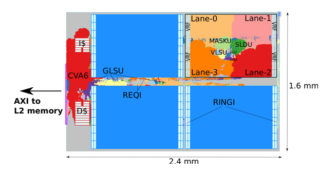
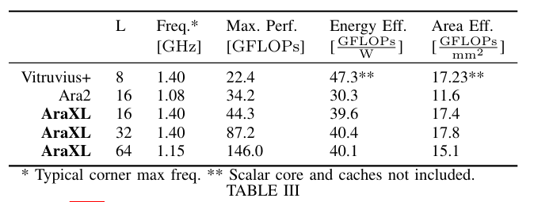
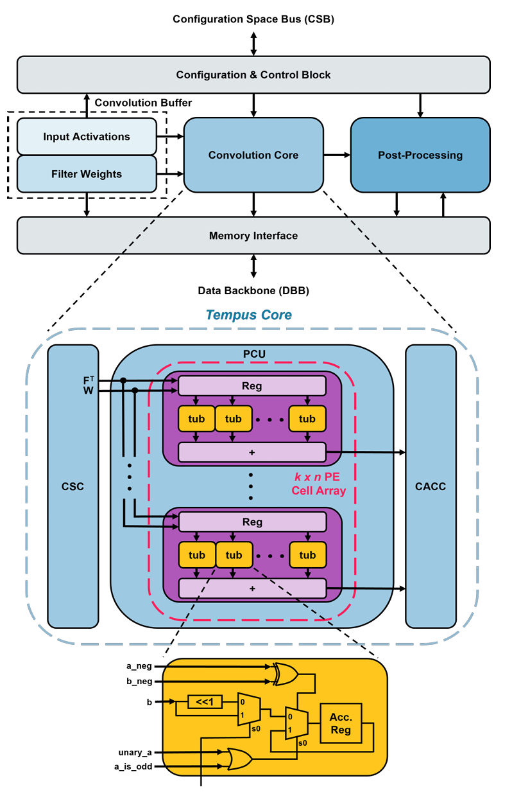
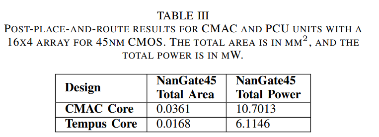
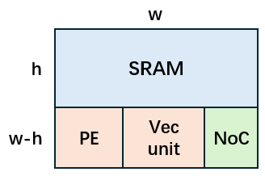
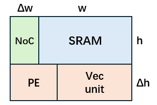
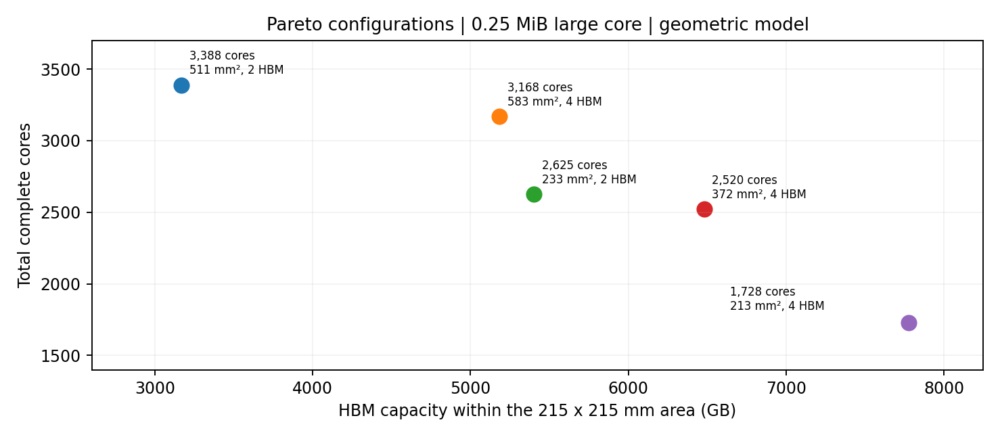

# 1. Core

## 1.1 功能单元面积建模

### 1.1.1 SRAM建模

运行NVSIM仿真器（ https://github.com/SEAL-UCSB/NVSim ）：

固定wordwidth为1024bits，得到SRAM的尺寸：

采用基于SRAM位单元面积比的工艺缩放法，在假设面积利用率不变的条件下，将22nm工艺下的SRAM面积映射至7nm工艺：

| SRAM 容量 | 22nm 长 (mm) | 22nm 宽 (mm) | 7nm 长 (mm) | 7nm 宽 (mm) |
| --- | --- | --- | --- | --- |
| 0.25 MiB | 0.65782 | 0.22528 | 0.40662 | 0.13925 |
| 0.50 MiB | 1.31564 | 0.22528 | 0.81324 | 0.13925 |
| 0.75 MiB | 1.97345 | 0.22528 | 1.21986 | 0.13925 |
| 1.00 MiB | 2.63127 | 0.22528 | 1.62648 | 0.13925 |
| 1.25 MiB | 3.28909 | 0.22528 | 2.03310 | 0.13925 |
| 1.50 MiB | 3.94691 | 0.22528 | 2.43972 | 0.13925 |
| 1.75 MiB | 4.60472 | 0.22528 | 2.84634 | 0.13925 |
| 2.00 MiB | 5.26254 | 0.22528 | 3.25296 | 0.13925 |

### 1.1.2 vec unit建模

Vec unit由lane（向量通道）组成，每个lane中有FPU、reg等。

参考16-lane AraXL（ https://arxiv.org/pdf/2501.10301 ）的平面图，在22nm工艺下，尺寸约为2.4mm * 1.6mm / 16lanes：

论文 AraXL 的 16-lane 实例在 1.4 GHz 下达到 44.3 GFLOPS；文中基准为双精度 FP64（DP）浮点运算。按每条 64-bit lane 在相同时钟下可并行执行 2 路 FP32 FMA 的理想 SIMD 等效假设，换算为 88.6 FP32 GFLOPS（16 lanes、1.4 GHz），该数值不是论文实测的 FP32 吞吐。

将运行频率统一为 1 GHz，16 lanes 的原始 FP64 性能为约 31.64 FP64 GFLOPS；按 64-bit/32-bit=2 的 FP32 并行宽度换算，同一组 16 lanes 的 FP32 等效吞吐为约 63.28 FP32 GFLOPS。换算仅用于本面积/峰值模型，不表示实际 FP32 测试或精度等价。

在 7nm、1 GHz 的建模口径下，每个 Vec lane 的 FP32 等效峰值为 3.9554 GFLOPS（原 FP64 基准 1.9777 GFLOPS/lane × 2），均摊估算尺寸仍取 0.1897 mm × 0.1265 mm（含分摊的共享逻辑）。这里假定 FP32 SIMD 吞吐翻倍不增加 lane 的面积，属于待物理实现验证的面积/吞吐假设。论文来源：https://arxiv.org/pdf/2501.10301 。

### 1.1.3 PE阵列建模

参照NVDLA（NVIDIA的开源神经网络推理加速器框架）结构（ https://arxiv.org/pdf/2412.19002 ）

NVDLA的结构为：

CMAC Core的尺寸为：

基于论文中 45nm 工艺下、16×4 INT4 CMAC 阵列的面积数据，将其均分到 64 个等效乘法计算位置，得到等效单元平均面积为 0.000564 mm²。假设向目标工艺节点迁移时面积缩小至原来的 1/15，则等效单元面积为 0.0000376 mm²，对应正方形边长约 6.13μm。该估算包含平均分摊的外围逻辑开销，不代表目标工艺节点的实际物理实现结果。假设每单元每周期完成一次 MAC，则 522 个单元在 1GHz 下的理论峰值算力为 1.044 TOPS（整数运算）。

### 1.1.4 NoC 建模

本节将 Core 内 SRAM、PE、Vec 之间的通信互连，与 Die 内 Core 间 2D Mesh 的 Router、网络接口和 Link 合并建模。NoC 面积作为分摊到每个 Core 的统一等效面积预算；已包含在功能单元面积中的电路不重复计入。

以 NoC 数据位宽 B 为新增探索变量，取 B∈{64,128,256,512} bit，基准位宽 B₀=256 bit。设 L₀ 为相应大小核在基准位宽下的 Core 边长，沿用基准 NoC 占 Core 总面积 15% 的假设，即 A_noc,0=0.15L₀²。

A_noc(B) = A_noc,0 [0.20 + 0.80(B/256)]

其中 0.20 表示与位宽近似无关的路由、仲裁和控制开销，0.80 表示随位宽近似线性增长的缓冲、交换数据通路、接口和 Link 开销。两系数固定、不参与探索，大小核统一采用；因此在同一基准 Core 下，NoC 面积随位宽严格增大。该缩放关系参考 ASIC Router 不同位宽的综合面积变化（https://arxiv.org/pdf/1411.3492），属于一阶架构估计，不代表完整 7 nm NoC 的实测面积。

## 1.2 大小核布局：固定基准 Core 尺寸与可变 NoC 面积约束

### 1.2.1 功能单元参数、NoC 位宽与算力约束

| 对象 | 7nm、1 GHz 建模参数 | 计算或安装口径 |
| --- | --- | --- |
| SRAM | 长边 a、短边 b（见 1.1.1） | A_sram=a×b；长宽不拉伸 |
| Vec lane | 0.1897 × 0.1265 mm | 3.9554 FP32 GFLOPS/lane（等效峰值）；可旋转 90° |
| PE 等效单元 | A_pe=0.0000376 mm² | INT4：1 MAC/周期 = 2 GOPS/单元 |
| NoC | B∈{64,128,256,512} bit；B₀=256 bit | g(B)=0.20+0.80(B/256)；A_noc(B)=0.15L₀²g(B) |
| 名义算力目标 | PE(INT4 GOPS) : Vec(FP32 GFLOPS) ≈ 10 : 1 | N_pe=round_half_up(19.777 N_vec) |

使用 1.1.1 表中的 7nm SRAM 物理长边 a、短边 b（b=0.13925 mm，a=0.40662～3.25296 mm）；Vec 单元面积 A_vec=0.02399705 mm²。按 1.1.4 定义，同一个位宽 B 同时作用于 Core 内部互连和分摊到 Core 的 Die 内 Core 间 Mesh，大小核共用固定缩放函数 g(B)=0.20+0.80(B/256)。L₀ 专指 B=256 bit 时相应 Core 的边长，A_noc,0=0.15L₀²；对每个固定的 Core 配置，A_noc(B)=A_noc,0g(B)，不能把随位宽变化的 L(B) 代回该基准面积公式。为避免位宽加大却意外增加可安装计算资源，本节各容量的 Core 外形固定为 L=L₀，仅重新分配 NoC 与 PE/Vec 的占位。

固定 1 GHz：P_vec,FP32=3.9554N_vec GFLOPS（FP32 等效峰值），P_pe,INT4=2N_pe GOPS（INT4 MAC 按每次 2 次整数操作）。保持 PE:Vec≈10:1 的名义操作率目标，N_pe=round_half_up(19.777N_vec)；round_half_up 为 0.5 向上取整。PE 的 INT4 精度、单位面积与峰值定义不变，全部算力只统计实际装入的整数单元。

### 1.2.2 小核：SRAM 长边直接确定 L

小核空间布局：图示为 B=256 bit、0.25 MiB 的基准几何比例

小核将 SRAM 长边 a 水平放置，Core 边长始终取 L=L₀=a，SRAM 高为 b。底部计算带高度 H=L₀−b；NoC 在计算带右侧，按 1.1.4 随位宽改变其预留宽度，SRAM 长宽及 Core 外轮廓均不改变。

令 A₀=0.15L₀²，g=g(B)。NoC 等效宽度 w_noc(B)=A₀g/H；PE+Vec 可用计算矩形宽 W(B)=L₀−w_noc(B)，高 H=L₀−b，面积 S(B)=W(B)H=L₀²−ab−A₀g。每个候选 B 均须满足 W(B)>0；当 B=256 bit（g=1）时，严格退化到原来的 W、H 及 15% NoC 基准布局。

### 1.2.3 大核：256 bit 基准几何与可变 NoC 占位

大核空间布局：图示为 B=256 bit 时 SRAM 竖置、NoC 在左侧的基准形状

大核沿用 256 bit 基准的方形 Core 几何。若 SRAM 水平放置，按原有“左侧 NoC 与 SRAM 等高、占基准 Core 的 15%”约束，会得到 0.15L₀²−bL₀+ab=0；其实数根需 b≥0.6a，而表内 SRAM 均不满足。因此基准布局仍将 SRAM 旋转 90°，使其水平宽 b、竖直高 a。

在基准位宽 B₀=256 bit，取上方 SRAM 左侧的 NoC 宽 Δw₀=L₀−b，满足 aΔw₀=0.15L₀²，即 0.15L₀²−aL₀+ab=0。仅取可容纳下方计算带的根 L₀=[a+√(a²−0.6ab)]/0.3（L₀≥a）。此方程只计算一次基准边长；变更 B 时不再重解方程，也不令 A_noc(B)=0.15L(B)²。

置 A₀=aΔw₀=0.15L₀²、g=g(B)，固定 L=L₀，NoC 总预算 A_noc(B)=gA₀。为保持方形外形及基准结果，允许 NoC 等效占位在 SRAM 左侧与下方计算带之间调整：当 g≤1 时，上方 NoC 宽为 gΔw₀，腾出的上方计算区为 (W₂,H₂)=((1−g)Δw₀,a)，下方计算区为 (W₁,H₁)=(L₀,L₀−a)；当 g≥1 时，上方 NoC 保持宽 Δw₀，新增面积 (g−1)A₀ 在下方左侧占宽 δw=(g−1)A₀/(L₀−a)，于是 (W₁,H₁)=(L₀−δw,L₀−a)，上方计算区为空（W₂=0）。要求 W₁>0、W₂≥0；两种情况下均有 S(B)=W₁H₁+W₂H₂=L₀²−ab−A₀g。B=256 bit 时 g=1、W₂=0，原有 W=L₀、H=L₀−a 的单计算带布局完全保留。这里的 NoC 区域是两级互连共同的等效面积预算，不要求所有实际 Router/Link 连成同一实体矩形。

### 1.2.4 PE/Vec 整数排布及有效占用宽度

将 1.2.2 或 1.2.3 得到的非空计算矩形记为区域 j（小核仅一块；大核至多两块），尺寸为 Wⱼ×Hⱼ。每块区域独立选择 Vec 横放 (v_w,v_h)=(0.1897,0.1265) mm 或竖放 (0.1265,0.1897) mm，排列 Kⱼ 列×Rⱼ 行；空置时 Kⱼ=Rⱼ=0。总 Vec 数 N_vec=ΣⱼKⱼRⱼ，总 PE 数按整个 Core 的名义算力比统一计算：N_pe=round_half_up(19.777N_vec)，不逐区域单独取整。

PE 单元边长 a_pe=√0.0000376≈0.006131884 mm。将 N_pe 分配为各区域非负整数 N_pe,ⱼ，满足 ΣⱼN_pe,ⱼ=N_pe。非空区域的每 PE 列容量 r_pe,ⱼ=⌊Hⱼ/a_pe⌋；需用列数 C_pe,ⱼ=⌈N_pe,ⱼ/r_pe,ⱼ⌉（N_pe,ⱼ=0 时取 0）。区域 j 的占用宽 w_vec,ⱼ=Kⱼv_w,ⱼ、w_pe,ⱼ=C_pe,ⱼa_pe，横向剩余 w_free,ⱼ=Wⱼ−w_vec,ⱼ−w_pe,ⱼ。PE 末列可不满，未装入者不计入峰值。

每块区域需满足 Kⱼ、Rⱼ、N_pe,ⱼ 为非负整数；有 Vec 时 Kⱼ、Rⱼ≥1 且 Rⱼv_h,ⱼ≤Hⱼ；有 PE 时 r_pe,ⱼ≥1；并满足 Kⱼv_w,ⱼ+C_pe,ⱼa_pe≤Wⱼ。同时核查总面积 N_vecA_vec+N_peA_pe≤S(B)。不同区域的 Vec 方向和 PE 列数可不同；w_free,ⱼ 只表示该区域未使用的横向宽度，不将空白面积计入算力。B=256 bit 时大核的第二区域为空，计算规则与原单矩形排布一致。

### 1.2.5 固定基准 L 下的配置选取与复算

对每种 SRAM 容量、大小核类型及 B∈{64,128,256,512} bit，先按上述规则确定不重叠的可用计算区域，再枚举各区域 Vec 方向、Kⱼ、Rⱼ 及 PE 整数分配；仅保留同时满足 10:1 名义算力比、各区域几何及总面积约束的候选。选择 N_vec 最大的配置；并列时优先最小化 Σⱼ(w_free,ⱼHⱼ)，即计算区域的横向空白总面积。B 增大只减少可用计算面积，不使 Core 外形或额外计算空间增加。

复算顺序：读取 SRAM 的 a、b → 计算 256 bit 基准 L₀ 与 A₀ → 逐一代入位宽 B，得到 g(B)、A_noc(B) → 按大小核规则确定一块或两块计算矩形 → 枚举 Vec/PE 整数排布并核查面积 → 输出 N_vec、N_pe、各区有效宽度与峰值算力。无需对不同 B 重新求解 Core 边长；1.3 节分别列出四档位宽重新枚举后的结果。

基准复核：B=256 bit、0.25 MiB 小核有 L₀=406.62 μm、W≈313.86 μm、H=267.37 μm，取 Vec 竖放 K×R=2×1、N_vec=2，按名义比例安装 N_pe=40 个 PE，可得到 w_vec=253.00 μm、w_pe≈6.13 μm，峰值分别为 7.911 FP32 GFLOPS 和 80 INT4 GOPS；该配置用于核对新旧模型在基准位宽下的一致性。

## 1.3 探索结果（NoC 位宽 64、128、256、512 bit）

按 1.1.4 和 1.2 节的统一 NoC 面积模型，分别对四档位宽、八种 SRAM 容量和大小核进行 PE/Vec 整数排布搜索。每个 Core 的边长 L₀ 由 256 bit 基准几何确定并保持不变；位宽只改变 NoC 预留面积及可用计算区域。优先选取可安装 Vec lane 数最多的配置，并列时按照 1.2.5 的空白面积准则选取。

表中 FP32 算力为 Vec 等效峰值（3.9554 GFLOPS/lane），INT4 算力为 PE 峰值（2 GOPS/单元）；N_pe=round_half_up(19.777N_vec)。对于 64/128 bit 大核，排布列的“下/上”分别表示下方主计算带、上方 NoC 缩窄释放的计算区，PE 列数按两区分配；其余配置只有一块计算区。

#### NoC 位宽 B = 64 bit：大小核 PE/Vec 安装数量与算力

| 核型/SRAM (MiB) | Vec lane | PE (个) | Vec FP32 (GFLOPS) | PE INT4 (GOPS) | Core L₀ (μm) | Vec 排布 K×R / PE列 | PE/Vec 算力比 |
| --- | --- | --- | --- | --- | --- | --- | --- |
| 小 / 0.25 | 2 | 40 | 7.911 | 80 | 406.62 | 竖2×1/1 | 10.113:1 |
| 小 / 0.50 | 15 | 297 | 59.331 | 594 | 813.24 | 竖5×3/3 | 10.012:1 |
| 小 / 0.75 | 40 | 791 | 158.216 | 1582 | 1219.86 | 竖8×5/5 | 9.999:1 |
| 小 / 1.00 | 77 | 1523 | 304.566 | 3046 | 1626.48 | 竖11×7/7 | 10.001:1 |
| 小 / 1.25 | 126 | 2492 | 498.380 | 4984 | 2033.10 | 竖14×9/9 | 10.000:1 |
| 小 / 1.50 | 204 | 4035 | 806.902 | 8070 | 2439.72 | 竖17×12/11 | 10.001:1 |
| 小 / 1.75 | 280 | 5538 | 1107.512 | 11076 | 2846.34 | 竖20×14/13 | 10.001:1 |
| 小 / 2.00 | 368 | 7278 | 1455.587 | 14556 | 3252.96 | 竖23×16/15 | 10.000:1 |
| 大 / 0.25 | 243 | 4806 | 961.162 | 9612 | 2563.55 | 下横13×17/14；上竖11×2/4 | 10.000:1 |
| 大 / 0.50 | 1037 | 20509 | 4101.750 | 41018 | 5278.58 | 下横27×35/25；上竖23×4/23 | 10.000:1 |
| 大 / 0.75 | 2382 | 47109 | 9421.763 | 94218 | 7990.68 | 下横42×53/3；上竖26×6/227 | 10.000:1 |
| 大 / 1.00 | 4276 | 84566 | 16913.290 | 169132 | 10702.11 | 下横56×71/12；上横25×12/258 | 10.000:1 |
| 大 / 1.25 | 6749 | 133475 | 26694.995 | 266950 | 13413.29 | 下横69×89/52；上横38×16/118 | 10.000:1 |
| 大 / 1.50 | 9832 | 194447 | 38889.493 | 388894 | 16124.34 | 下竖126×72/30；上横40×19/326 | 10.000:1 |
| 大 / 1.75 | 13422 | 265447 | 53089.379 | 530894 | 18835.31 | 下横97×126/70；上竖80×15/179 | 10.000:1 |
| 大 / 2.00 | 17534 | 346770 | 69353.984 | 693540 | 21546.24 | 下竖166×96/89；上竖94×17/155 | 10.000:1 |

#### NoC 位宽 B = 128 bit：大小核 PE/Vec 安装数量与算力

| 核型/SRAM (MiB) | Vec lane | PE (个) | Vec FP32 (GFLOPS) | PE INT4 (GOPS) | Core L₀ (μm) | Vec 排布 K×R / PE列 | PE/Vec 算力比 |
| --- | --- | --- | --- | --- | --- | --- | --- |
| 小 / 0.25 | 2 | 40 | 7.911 | 80 | 406.62 | 竖2×1/1 | 10.113:1 |
| 小 / 0.50 | 15 | 297 | 59.331 | 594 | 813.24 | 竖5×3/3 | 10.012:1 |
| 小 / 0.75 | 40 | 791 | 158.216 | 1582 | 1219.86 | 竖8×5/5 | 9.999:1 |
| 小 / 1.00 | 77 | 1523 | 304.566 | 3046 | 1626.48 | 竖11×7/7 | 10.001:1 |
| 小 / 1.25 | 126 | 2492 | 498.380 | 4984 | 2033.10 | 竖14×9/9 | 10.000:1 |
| 小 / 1.50 | 198 | 3916 | 783.169 | 7832 | 2439.72 | 横11×18/11 | 10.000:1 |
| 小 / 1.75 | 273 | 5399 | 1079.824 | 10798 | 2846.34 | 横13×21/13 | 10.000:1 |
| 小 / 2.00 | 360 | 7120 | 1423.944 | 14240 | 3252.96 | 横15×24/15 | 10.000:1 |
| 大 / 0.25 | 236 | 4667 | 933.474 | 9334 | 2563.55 | 下横13×17/14；上横5×3/2 | 9.999:1 |
| 大 / 0.50 | 1005 | 19876 | 3975.177 | 39752 | 5278.58 | 下横27×35/25；上竖15×4/19 | 10.000:1 |
| 大 / 0.75 | 2310 | 45685 | 9136.974 | 91370 | 7990.68 | 下横42×53/3；上竖14×6/220 | 10.000:1 |
| 大 / 1.00 | 4145 | 81976 | 16395.133 | 163952 | 10702.11 | 下横55×71/43；上竖30×8/70 | 10.000:1 |
| 大 / 1.25 | 6534 | 129223 | 25844.584 | 258446 | 13413.29 | 下横70×89/21；上横19×16/278 | 10.000:1 |
| 大 / 1.50 | 9524 | 188356 | 37671.230 | 376712 | 16124.34 | 下竖127×72/9；上横20×19/424 | 10.000:1 |
| 大 / 1.75 | 12990 | 256903 | 51380.646 | 513806 | 18835.31 | 下竖145×84/80；上竖54×15/105 | 10.000:1 |
| 大 / 2.00 | 16978 | 335774 | 67154.781 | 671548 | 21546.24 | 下横112×144/48；上竖50×17/364 | 10.000:1 |

#### NoC 位宽 B = 256 bit：大小核 PE/Vec 安装数量与算力

| 核型/SRAM (MiB) | Vec lane | PE (个) | Vec FP32 (GFLOPS) | PE INT4 (GOPS) | Core L₀ (μm) | Vec 排布 K×R / PE列 | PE/Vec 算力比 |
| --- | --- | --- | --- | --- | --- | --- | --- |
| 小 / 0.25 | 2 | 40 | 7.911 | 80 | 406.62 | 竖2×1/1 | 10.113:1 |
| 小 / 0.50 | 15 | 297 | 59.331 | 594 | 813.24 | 竖5×3/3 | 10.012:1 |
| 小 / 0.75 | 40 | 791 | 158.216 | 1582 | 1219.86 | 横5×8/5 | 9.999:1 |
| 小 / 1.00 | 70 | 1384 | 276.878 | 2768 | 1626.48 | 竖10×7/6 | 9.997:1 |
| 小 / 1.25 | 117 | 2314 | 462.782 | 4628 | 2033.10 | 竖13×9/8 | 10.000:1 |
| 小 / 1.50 | 180 | 3560 | 711.972 | 7120 | 2439.72 | 竖15×12/10 | 10.000:1 |
| 小 / 1.75 | 252 | 4984 | 996.761 | 9968 | 2846.34 | 竖18×14/12 | 10.000:1 |
| 小 / 2.00 | 336 | 6645 | 1329.014 | 13290 | 3252.96 | 竖21×16/14 | 10.000:1 |
| 大 / 0.25 | 221 | 4371 | 874.143 | 8742 | 2563.55 | 横13×17/13 | 10.001:1 |
| 大 / 0.50 | 920 | 18195 | 3638.968 | 36390 | 5278.58 | 竖40×23/25 | 10.000:1 |
| 大 / 0.75 | 2135 | 42224 | 8444.779 | 84448 | 7990.68 | 竖61×35/39 | 10.000:1 |
| 大 / 1.00 | 3854 | 76221 | 15244.112 | 152442 | 10702.11 | 竖82×47/52 | 10.000:1 |
| 大 / 1.25 | 6052 | 119690 | 23938.081 | 239380 | 13413.29 | 横68×89/65 | 10.000:1 |
| 大 / 1.50 | 8856 | 175145 | 35029.022 | 350290 | 16124.34 | 竖123×72/79 | 10.000:1 |
| 大 / 1.75 | 12096 | 239223 | 47844.518 | 478446 | 18835.31 | 竖144×84/92 | 10.000:1 |
| 大 / 2.00 | 15840 | 313268 | 62653.536 | 626536 | 21546.24 | 竖165×96/106 | 10.000:1 |

#### NoC 位宽 B = 512 bit：大小核 PE/Vec 安装数量与算力

| 核型/SRAM (MiB) | Vec lane | PE (个) | Vec FP32 (GFLOPS) | PE INT4 (GOPS) | Core L₀ (μm) | Vec 排布 K×R / PE列 | PE/Vec 算力比 |
| --- | --- | --- | --- | --- | --- | --- | --- |
| 小 / 0.25 | 2 | 40 | 7.911 | 80 | 406.62 | 横1×2/1 | 10.113:1 |
| 小 / 0.50 | 12 | 237 | 47.465 | 474 | 813.24 | 竖4×3/3 | 9.986:1 |
| 小 / 0.75 | 32 | 633 | 126.573 | 1266 | 1219.86 | 横4×8/4 | 10.002:1 |
| 小 / 1.00 | 56 | 1108 | 221.502 | 2216 | 1626.48 | 竖8×7/5 | 10.004:1 |
| 小 / 1.25 | 99 | 1958 | 391.585 | 3916 | 2033.10 | 竖11×9/7 | 10.000:1 |
| 小 / 1.50 | 156 | 3085 | 617.042 | 6170 | 2439.72 | 竖13×12/9 | 9.999:1 |
| 小 / 1.75 | 210 | 4153 | 830.634 | 8306 | 2846.34 | 竖15×14/10 | 10.000:1 |
| 小 / 2.00 | 272 | 5379 | 1075.869 | 10758 | 3252.96 | 竖17×16/11 | 9.999:1 |
| 大 / 0.25 | 187 | 3698 | 739.660 | 7396 | 2563.55 | 横11×17/11 | 9.999:1 |
| 大 / 0.50 | 805 | 15920 | 3184.097 | 31840 | 5278.58 | 横23×35/22 | 10.000:1 |
| 大 / 0.75 | 1855 | 36686 | 7337.267 | 73372 | 7990.68 | 横35×53/34 | 10.000:1 |
| 大 / 1.00 | 3290 | 65066 | 13013.266 | 130132 | 10702.11 | 横47×70/44 | 10.000:1 |
| 大 / 1.25 | 5192 | 102682 | 20536.437 | 205364 | 13413.29 | 竖88×59/56 | 10.000:1 |
| 大 / 1.50 | 7632 | 150938 | 30187.613 | 301876 | 16124.34 | 竖106×72/68 | 10.000:1 |
| 大 / 1.75 | 10332 | 204336 | 40867.193 | 408672 | 18835.31 | 竖123×84/79 | 10.000:1 |
| 大 / 2.00 | 13536 | 267701 | 53540.294 | 535402 | 21546.24 | 竖141×96/90 | 10.000:1 |

结果核查：四档位宽对应 NoC 面积相对 256 bit 基准的倍数依次为 0.40、0.60、1.00、1.80；各配置均满足计算区几何、PE/Vec 整数排布与约 10:1 的名义算力比约束。仅当 B=256 bit 时，NoC 基准面积占 Core 的 15%，该档与原有结果一致。

大核的基准 Core 边长仍约为 2.56～21.55 mm，须在后续计算 Die 的可变尺寸整数矩形排布时检查是否能放入。表中算力为理想峰值，不包含互连拥塞、实际带宽、时序、功耗及良率限制；PE 的 INT4 GOPS 与 Vec 的 FP32 等效 GFLOPS 仅作名义操作率比较，不代表同精度性能。

在后续 Die 内 Core 整数矩形阵列与系统模块网格排布中，应按本节相应的 Core 配置和固定 L₀（mm）计算可安装的完整 Core 数；未装入的计算区空间不计入算力。

# 2. Die：以整数拼接反推动态面积

建模声明：本版不再预设任何小/中/大固定面积档位。Die 的宽度、长度及面积由 Core 整数阵列、HBM 几何、曝光场、Wafer 模块铺排和带宽约束共同生成；第 1 章的 Core 功能单元参数、大小核类型、四档 NoC 位宽及相应理想峰值不变。

## 2.1 设计变量、面积边界和物理口径

本版的“计算 Die”专指独立逻辑硅片；含该 Die、HBM、间隙及分摊 Die 间 NoC 的矩形单元称“模块”。二者面积、带宽和面积利用率应分别统计。计算 Die 允许正方形及长方形，不设置三档预定义尺寸。

| 类型 | 变量与设定 | 属性/说明 |
| --- | --- | --- |
| 主面积窗口 | 200 ≤ A_die ≤ 800 mm² | 工程 DSE 搜索假设，非学界/业界统一面积标准 |
| 下界敏感性 | 150 ≤ A_die < 200 mm² | 检查主下界是否漏掉极小 Die 非支配解 |
| 曝光场 | (W≤26,H≤33) 或 (W≤33,H≤26) mm | 假设标准单次 26×33 mm 场，明确允许旋转 |
| 形状限制 | max(W,H)/min(W,H) ≤ 2 | 主搜索工程筛选；宽松比例另做敏感性实验 |
| 外围预留 | ex=ey=0.10 mm；Core pitch=0 | 用于本次可复算示例，不等于实际 PDK/PHY 可布面积 |
| Core 配置 | 16 种大小核×SRAM；4 档 NoC 位宽 | 共 64 种；Core 几何在四档位宽中固定 |
| HBM 数量 | 每排 n∈{1,…,14}，每模块 2n 颗 | 最终依带宽、曝光场与模块装配约束自动筛选 |

上界来源：业界标准 26×33 mm 曝光场名义面积为 858 mm²，但面积≤858 不能替代长宽约束；以 800 mm² 为主动搜索上界，保留边界与工艺余量。NVIDIA H100（814 mm²）、Tesla Dojo D1（645 mm²）为大规模 AI 计算 Die 的工业例证；它们不是所有 AI 架构的最优面积。参考资料见附录 D。

下界来源：不存在跨工艺、跨封装、跨 HBM 数量通用的最小计算 Die 面积标准。按原 bump 假设，通信理论预算 B_bump(A)=41.322314×A GB/s。四颗 HBM 的峰值合计 4710.4 GB/s，要求非负 D2D 时 A 至少约 114.0 mm²；200 mm² 下界额外考虑完整 Core 阵列规模和系统拼接研究的可比性，属于明确的工程筛选参数。减少 HBM、改变 PHY 与 D2D 要求时，应重估下界。

## 2.2 动态 Die 构建：Core 与 bump

设方形 Core 的边长 L_c 取第 1.3 节对应型号的固定 L₀（mm）。对每个候选枚举 Core 列数 Nx≥1 和行数 Ny≥1，最小 Die 外形为 W₀=NxL_c+(Nx−1)p_x+e_x；H₀=NyL_c+(Ny−1)p_y+e_y。当前计算取 p_x=p_y=0、e_x=e_y=0.10 mm。由此得 A₀=W₀H₀；实际物理设计应把此简化预留替换为 seal ring、I/O/PHY、功率网络和 Core-to-Core 走线模型。

如果 A₀ 小于面积下界或 HBM 通信所需最小面积，本次搜索只在满足最低面积的边界上测试：保持宽度扩展高度、保持高度扩展宽度、宽高等比例扩展三种候选。若 A₀ 已满足，则采用最小可行宽高。这保证可复算，并刻意不把无限连续外形都算作已穷举；对 D2D 带宽作为显式优化目标的工作，应继续扫描可用余量。

B_bump(A)=[A/(0.055×0.055)]×0.4×2.5/8=41.322314A（GB/s），其中每 bump 2.5 Gb/s、40% 用于通信。B_HBM=2n×1177.6 GB/s，双向 D2D 剩余预算 B_D2D,bi=B_bump−B_HBM≥0，单向 D2D 取一半。这里为理想 bump 面积平均模型，不能解释为 PHY 一定可达到相同端口密度或带宽。

## 2.3 HBM 模块的几何与带宽

HBM3E 继续采用原文 Micron MT65B18G16120A00QH-92:A，容量 36 GB/颗、接口 1024-bit×9.2 Gb/s，单颗理论带宽 1177.6 GB/s，平面尺寸 10.98×10.98 mm；封装高度 0.78 mm 不进入二维排布。

定义 n 为每排 HBM 数量，模块含两排共 2n 颗；采用原文两排几何一致版，0.15 mm 的 HBM 间距、Die-to-HBM 间距和模块四周留白不变：

W_HBM,row=n×10.98+(n−1)×0.15；W_mod=max(W_die,W_HBM,row)+0.30（mm）。

H_mod=H_die+2×10.98+4×0.15=H_die+22.56（mm）。

“同侧两排”和“两侧各一排”在当前只计算外廓的模型中具有相同 W_mod 和 H_mod，不宣称真实 PHY、供电或互连长度相同。允许 HBM 排宽超过 Die 宽度，但必须扩大模块外廓，并标注此类版图尚未通过物理设计验证。

每模块 HBM 容量为 72n GB；理论 HBM 带宽为 2355.2n GB/s。HBM 数量变化时必须同步重算 bump 预算、模块排宽和 Wafer 行列数，不再用固定 HBM 颗数或固定 Die 面积的表格代入。

## 2.4 Die 面积双向搜索：Core-first 与 Wafer-first

### 2.4.1 方法 A——先紧密排列 Core（Core-first）

① 遍历 Core 类型、SRAM 容量与 NoC 位宽；② 枚举整数 Nx、Ny，生成最小可行 Die 长宽；③ 若通信或最小面积要求更高，只做定义好的三类面积边界扩展；④ 枚举 n，并用第 2.3 节得到模块外形；⑤ 计算 Wafer 整数网格并筛选曝光场、面积、长宽比、接口预算等；⑥ 输出整片 Core 数、INT4/FP32 分别的理想峰值、HBM 容量与各层面积利用率。

优点是避免放大 Die 却没有增加完整 Core；风险是若只局部选择“最紧凑 Core 阵列”，可能错过 Wafer 模块数骤变前的其它更优配置。因此方法 A 必须结合整片系统目标排序，不能逐 Die 局部贪心。

### 2.4.2 方法 B——先紧密排列 Wafer 模块（Wafer-first）

① 枚举模块列数 Mx 和行数 My；② 根据 215×215 mm 可铺排区和模块间 NoC 比例反推允许的模块基础宽高上界；③ 扣掉 HBM 两排占位后得到 Die 可用长宽区间；④ 反算可容纳的整数 Nx、Ny，确认最小面积、曝光场、长宽比及 bump 通信预算；⑤ 对所有可行网格计算整片性能，并与方法 A 的候选去重比对。

令 S=215√0.9≈203.96 mm。固定 Mx×My 时，模块上界 W_mod≤S/Mx、H_mod≤S/My。因此 Die 的上界 W_die≤S/Mx−0.30、H_die≤S/My−22.56，还须满足 W_HBM,row+0.30≤S/Mx。长宽并不是一律取到上界，而是从能容纳完整 Core 的几何断点选取。

重要等价性：在完全相同的可行集合上，两种全枚举路径应产生一致的最优值及 Pareto 前沿。方法 B 不是另一个独立的目标函数，而是用于反向生成并核验 Core-first 的几何结果。

## 2.5 统一优化目标与筛选准则

主目标 A（整片理论峰值计算）：先最大化 Core 总数×相应 Core PE INT4 GOPS；同分时优先整片 HBM 容量、再优先 D2D 余量。由于 Vec 与 PE 保持近似固定操作率比例，FP32 另列并复算，绝不与 INT4 直接相加。

主目标 B（整片 HBM 容量）：最大化 MxMy×2n×36 GB；同分时需进一步比较整片计算峰值、D2D 预算及实际布线可行性。两目标不预设任意权重；对给定 Core，保留“总 Core 数—HBM 总容量”的二维非支配前沿。

报告的面积指标包含：η_core/die=(NxNyL_c²)/A_die；η_core/region=(MxMyNxNyL_c²)/(215²)；η_module/region=(MxMyW_modH_mod)/(0.9×215²)。最后一项是含 HBM、间隙和等效 NoC 的模块占位率，不能与真正计算面积利用率混淆。

## 2.6 动态 Die 探索的数值结果

本节结果统一满足：200≤A_die≤800 mm²；标准 26×33 mm 单曝光场（允许旋转）；Die 长宽比≤2:1；外围 e_x=e_y=0.10 mm；Core pitch 为 0；HBM 每排 n=1…14；D2D 双向余量≥0；215×215 mm 方形系统区域及 10% Die 间 NoC 占位。结果均为理论几何与理想峰值，没有良率、真实 PHY 和热设计证明。

### 2.6.1 相同 Core 在不同优化目标下的非支配候选

| HBM/Die | 计算 Die（mm） | 面积(mm²) | Core/Die | 模块阵列 | Core/区域 | HBM GB/区域 |
| --- | --- | --- | --- | --- | --- | --- |
| 2 | 18.04×28.30 | 510.7 | 7×11 | 11×4 | 3,388 | 3,168 |
| 4 | 20.61×28.30 | 583.2 | 8×11 | 9×4 | 3,168 | 5,184 |
| 2 | 12.92×18.04 | 233.1 | 5×7 | 15×5 | 2,625 | 5,400 |
| 4 | 20.61×18.04 | 371.9 | 8×7 | 9×5 | 2,520 | 6,480 |
| 4 | 20.61×10.35 | 213.4 | 8×4 | 9×6 | 1,728 | 7,776 |

上表均使用 0.25 MiB 大核（L_c=2.56355 mm），为“Core 总数—HBM 容量”的二维非支配集。最大 Core 数的 510.65 mm² 配置每模块只配 2 颗 HBM；若要求 4 颗 HBM，583.20 mm² 的 8×11 Core、9×4 模块候选更均衡。另一个 371.88 mm² 候选实现 2520 个完整 Core 与 6480 GB HBM。

图 2-1 代表 Core 的两目标非支配点；所有横纵轴数值为本模型的整片系统预算。

### 2.6.2 64 种 Core 配置的整片计算峰值最优值

| B(bit) | 最优 Core | 计算 Die W×H(mm) | Core/Die | 模块阵列 | Core/区域 | INT4 POPS | FP32 PFLOPS | HBM GB |
| --- | --- | --- | --- | --- | --- | --- | --- | --- |
| 64 | 大/0.25 MiB | 18.04×28.30 | 7×11 | 11×4 | 3,388 | 32.565 | 3.256 | 3,168 |
| 128 | 大/0.25 MiB | 18.04×28.30 | 7×11 | 11×4 | 3,388 | 31.624 | 3.163 | 3,168 |
| 256 | 大/0.25 MiB | 18.04×28.30 | 7×11 | 11×4 | 3,388 | 29.618 | 2.962 | 3,168 |
| 512 | 大/0.25 MiB | 18.04×28.30 | 7×11 | 11×4 | 3,388 | 25.058 | 2.506 | 3,168 |

四档位宽下的几何最优解一致：0.25 MiB 大核、7×11 Core/Die、11×4 模块、每 Die 两颗 HBM，Die 约 510.65 mm²；区别来自 Core 内 NoC 位宽改变的 PE/Vec 实际安装数量。完整 64 配置复算见附录 A 与随附 CSV。该最优值针对“峰值计算优先”目标，带宽和热约束可能改变最终选择。

### 2.6.3 方法 A/B 的交叉核验

| 验证项 | Core-first | Wafer-first |
| --- | --- | --- |
| 指定核/记忆体 | 0.25 MiB 大核；4 HBM/Die | 同一配置 |
| Die 内 Core | 8×11 = 88 | 8×11 = 88 |
| Die 宽×高 | 20.61×28.30 | 允许宽高内的同一断点 |
| Wafer 模块 | 9×4 = 36 | 9×4 = 36 |
| 整片 Core 数 | 3,168 | 3,168 |
| 有效性 | 通过面积/曝光场/带宽 | 由网格上界反推并核查 |

该交叉核验覆盖了 n=2 下可行的 Wafer 模块网格，并在定义好的面积边界生成规则内得到相同最大 Core 数。不能据此声称真正布局布线的结果已经一致；若增加具体工艺约束，两条路径应重新联合枚举。

### 2.6.4 下界、外形比例与外围余量的敏感性测试

为检验工程搜索窗口是否过于武断，另对 0.25 MiB 大核重复扫描三项条件，其余均不变；下表仅代表该 Core，不等价于所有 64 种配置的敏感性结论。

| 最小面积(mm²) | 最大长宽比 | 总外围余量(mm/轴) | 峰值 Core/区域 | 固定4-HBM最大Core | 最大HBM容量(GB) |
| --- | --- | --- | --- | --- | --- |
| 200 | 2.0 | 0.10 | 3,388 | 3,168 | 7,776 |
| 150 | 2.0 | 0.10 | 3,388 | 3,168 | 7,776 |
| 200 | 3.0 | 0.10 | 3,388 | 3,168 | 7,776 |
| 200 | 2.0 | 0 | 3,432 | 3,168 | 7,776 |

在这一代表 Core 上，降低主面积下界到 150 mm² 或放宽长宽比至 3:1，并未改变三项最优值；但移除 0.10 mm 总外围余量，计算优先目标由 3,388 增至 3,432 个完整 Core。这证明整数铺排对物理边界敏感，当前的 0.10 mm 仅能视为待 PDK 校核的示例预留。

## 2.7 制造与系统真实性边界

当前 215×215 mm 表示“抽象的方形可铺排系统区域”，不是 300 mm 圆形晶圆上的实际可切割逻辑 Die 分布；HBM 与逻辑 Die 的二维共面模块也不能直接等同于某一种 CoWoS 或真正 wafer-scale monolithic 工艺。真实设计至少应拆分为：圆形制造 Wafer 的良品 Die/成本模型，以及 interposer/基板/wafer-scale 系统的模块封装与互连模型。

真实设计需要额外约束：按目标 foundry 的 reticle/seal ring 和划片道、HBM PHY 及可达端口位置、D2D 信号完整性、真实 NoC 拓扑拥塞、功耗/供电及散热密度、晶圆良率/冗余修复、跨 Die 链路时序与封装成本。原文 Vec FP32 吞吐翻倍及 PE 缩放均为建模假设，不能由几何优化结论证明其准确。

# 3. Wafer/超节点：动态模块铺排与全链路重算

## 3.1 模块等效互连预算与有效尺寸

本版保持原文“Die 间 NoC 占扩展后模块总占位面积 10%”的定义：A_eff=A_mod/0.9，A_noc,die-inter=0.1A_eff；长宽比不变时 W_eff=W_mod/√0.9、H_eff=H_mod/√0.9。此模型只表达空间预留，不允许把等效占位当成额外制造的实体 Die 面积。Core 内既有 NoC 预算和这里的 Die 间新增 NoC 不重复计入。

## 3.2 Wafer 整数格与各层面积利用率

Mx=floor(215/W_eff)，My=floor(215/H_eff)，N_mod=MxMy。模组总带宽上界为 N_mod×2n×1177.6 GB/s；HBM 总容量为 N_mod×2n×36 GB；模块系统理想峰值分别为 N_mod×NxNy×P_PE 与 N_mod×NxNy×P_Vec。所有 floor 操作均在未舍入的真实尺寸上完成。

Core/Die 的 Nx、Ny 先由几何得到，再计算模块宽高及 Mx、My。反推方法则先给定 Mx、My 对基础模块宽高设上界，最后对同一组整数结果进行双向校验；不再通过任何固定 Die 面积行查表。

## 3.3 整片资源和计算带宽对照

| 计算优先候选 | Die面积 | 模块/区域 | Core/区域 | HBM颗/区域 | HBM总带宽(TB/s) | HBM容量(GB) | Core面积比 |
| --- | --- | --- | --- | --- | --- | --- | --- |
| B=64 bit | 510.7 | 44 | 3,388 | 88 | 103.63 | 3,168 | 48.2% |
| B=128 bit | 510.7 | 44 | 3,388 | 88 | 103.63 | 3,168 | 48.2% |
| B=256 bit | 510.7 | 44 | 3,388 | 88 | 103.63 | 3,168 | 48.2% |
| B=512 bit | 510.7 | 44 | 3,388 | 88 | 103.63 | 3,168 | 48.2% |

注意：上述峰值对应每 Die 仅 2 颗 HBM。增大计算密度而不提高 HBM 带宽，会使每 Core 的可用内存带宽下降。因此工作负载层面需要增加 roofline/通信仿真才能判定实际吞吐是否随峰值同步提高。

## 3.4 HBM 容量优先时的不同最优解

在当前工程几何约束内，整片 HBM 容量最高为 7,776 GB，对应 216 颗 HBM3E；这不是唯一的 Core 选择。作为同一种 0.25 MiB 大核的对照，可选 20.61×10.35 mm Die（约 213.38 mm²），每 Die 4 颗 HBM、8×4 Core，Wafer 为 9×6=54 个模块，整片共 1,728 个 Core。

与计算优先的 3,388 Core/3,168 GB 方案相比，容量优先的 7,776 GB 方案牺牲了大量完整 Core 数。二者并无单一“绝对最优”，实际超节点应以目标模型的算存比和 D2D 压力筛选 Pareto 候选。

## 3.5 全量结果、边界与复核顺序

复算顺序：第 1 章读取每个 Core 的 L₀、PE/Vec 数→遍历 Nx、Ny 与 Die 几何→应用面积/长宽比/曝光场筛选→遍历 HBM n 并核算 bump/D2D→计算含 HBM 的模块真实外廓→追加 10% Die 间 NoC 的等效尺寸→求 Wafer 整数行列→累计 Core/算力/HBM→在相同目标函数下筛选最优及二维 Pareto。

随文附上可复算程序和三份 CSV：①每个 Core+位宽最优配置，②代表 Core 的二维 Pareto 前沿，③按 HBM 每排数和模块总数压缩后的几何备选集合。由于第三份数据为性能维度的压缩集，并非全部连续长宽，更复杂的 D2D/良率目标必须重新执行原始枚举。

## 附录 A：64 种 Core 配置的动态 Die 计算峰值最优表

说明：每行都是在同一 200–800 mm² 搜索窗口、26×33 mm 曝光场、最大 2:1 长宽比以及 0.10 mm 边缘示例余量下得到的独立最优配置。优先最大化整片 INT4 理论峰值（等价于该 Core 配置下最大化完整 Core 数），并列优先 HBM GB。完整高精度数值在 CSV 中。

### A.1  NoC = 64 bit

| 核型 / SRAM(MiB) | Die W×H(mm) | Die A(mm²) | Core/Die | 模块/区域 | HBM/Die | Core/区域 | INT4 POPS | FP32 PFLOPS | HBM GB |
| --- | --- | --- | --- | --- | --- | --- | --- | --- | --- |
| 小 / 0.25 | 20.02×28.16 | 563.8 | 49×69 | 10×4 | 2 | 135,240 | 10.819 | 1.070 | 2,880 |
| 小 / 0.50 | 22.06×27.75 | 612.1 | 27×34 | 9×4 | 4 | 33,048 | 19.631 | 1.961 | 5,184 |
| 小 / 0.75 | 22.06×28.16 | 621.1 | 18×23 | 9×4 | 4 | 14,904 | 23.578 | 2.358 | 5,184 |
| 小 / 1.00 | 17.99×27.75 | 499.3 | 11×17 | 11×4 | 2 | 8,228 | 25.062 | 2.506 | 3,168 |
| 小 / 1.25 | 24.50×26.53 | 649.9 | 12×13 | 8×4 | 4 | 4,992 | 24.880 | 2.488 | 4,608 |
| 小 / 1.50 | 22.06×26.94 | 594.2 | 9×11 | 9×4 | 4 | 3,564 | 28.761 | 2.876 | 5,184 |
| 小 / 1.75 | 28.56×25.72 | 734.6 | 10×9 | 7×4 | 4 | 2,520 | 27.912 | 2.791 | 4,032 |
| 小 / 2.00 | 13.11×26.12 | 342.5 | 4×8 | 15×4 | 2 | 1,920 | 27.948 | 2.795 | 4,320 |
| 大 / 0.25 | 18.04×28.30 | 510.7 | 7×11 | 11×4 | 2 | 3,388 | 32.565 | 3.256 | 3,168 |
| 大 / 0.50 | 21.21×26.49 | 562.0 | 4×5 | 9×4 | 4 | 720 | 29.533 | 2.953 | 5,184 |
| 大 / 0.75 | 32.06×24.07 | 771.8 | 4×3 | 6×4 | 6 | 288 | 27.135 | 2.713 | 5,184 |
| 大 / 1.00 | 21.50×32.21 | 692.6 | 2×3 | 9×3 | 4 | 162 | 27.399 | 2.740 | 3,888 |
| 大 / 1.25 | 13.51×26.93 | 363.9 | 1×2 | 14×4 | 2 | 112 | 29.898 | 2.990 | 4,032 |
| 大 / 1.50 | 16.22×32.35 | 524.8 | 1×2 | 12×3 | 2 | 72 | 28.000 | 2.800 | 2,592 |
| 大 / 1.75 | 18.94×18.94 | 358.5 | 1×1 | 10×4 | 2 | 40 | 21.236 | 2.124 | 2,880 |
| 大 / 2.00 | 21.65×21.65 | 468.6 | 1×1 | 9×4 | 4 | 36 | 24.967 | 2.497 | 5,184 |

### A.2  NoC = 128 bit

| 核型 / SRAM(MiB) | Die W×H(mm) | Die A(mm²) | Core/Die | 模块/区域 | HBM/Die | Core/区域 | INT4 POPS | FP32 PFLOPS | HBM GB |
| --- | --- | --- | --- | --- | --- | --- | --- | --- | --- |
| 小 / 0.25 | 20.02×28.16 | 563.8 | 49×69 | 10×4 | 2 | 135,240 | 10.819 | 1.070 | 2,880 |
| 小 / 0.50 | 22.06×27.75 | 612.1 | 27×34 | 9×4 | 4 | 33,048 | 19.631 | 1.961 | 5,184 |
| 小 / 0.75 | 22.06×28.16 | 621.1 | 18×23 | 9×4 | 4 | 14,904 | 23.578 | 2.358 | 5,184 |
| 小 / 1.00 | 17.99×27.75 | 499.3 | 11×17 | 11×4 | 2 | 8,228 | 25.062 | 2.506 | 3,168 |
| 小 / 1.25 | 24.50×26.53 | 649.9 | 12×13 | 8×4 | 4 | 4,992 | 24.880 | 2.488 | 4,608 |
| 小 / 1.50 | 22.06×26.94 | 594.2 | 9×11 | 9×4 | 4 | 3,564 | 27.913 | 2.791 | 5,184 |
| 小 / 1.75 | 28.56×25.72 | 734.6 | 10×9 | 7×4 | 4 | 2,520 | 27.211 | 2.721 | 4,032 |
| 小 / 2.00 | 13.11×26.12 | 342.5 | 4×8 | 15×4 | 2 | 1,920 | 27.341 | 2.734 | 4,320 |
| 大 / 0.25 | 18.04×28.30 | 510.7 | 7×11 | 11×4 | 2 | 3,388 | 31.624 | 3.163 | 3,168 |
| 大 / 0.50 | 21.21×26.49 | 562.0 | 4×5 | 9×4 | 4 | 720 | 28.621 | 2.862 | 5,184 |
| 大 / 0.75 | 32.06×24.07 | 771.8 | 4×3 | 6×4 | 6 | 288 | 26.315 | 2.631 | 5,184 |
| 大 / 1.00 | 21.50×32.21 | 692.6 | 2×3 | 9×3 | 4 | 162 | 26.560 | 2.656 | 3,888 |
| 大 / 1.25 | 13.51×26.93 | 363.9 | 1×2 | 14×4 | 2 | 112 | 28.946 | 2.895 | 4,032 |
| 大 / 1.50 | 16.22×32.35 | 524.8 | 1×2 | 12×3 | 2 | 72 | 27.123 | 2.712 | 2,592 |
| 大 / 1.75 | 18.94×18.94 | 358.5 | 1×1 | 10×4 | 2 | 40 | 20.552 | 2.055 | 2,880 |
| 大 / 2.00 | 21.65×21.65 | 468.6 | 1×1 | 9×4 | 4 | 36 | 24.176 | 2.418 | 5,184 |

### A.3  NoC = 256 bit

| 核型 / SRAM(MiB) | Die W×H(mm) | Die A(mm²) | Core/Die | 模块/区域 | HBM/Die | Core/区域 | INT4 POPS | FP32 PFLOPS | HBM GB |
| --- | --- | --- | --- | --- | --- | --- | --- | --- | --- |
| 小 / 0.25 | 20.02×28.16 | 563.8 | 49×69 | 10×4 | 2 | 135,240 | 10.819 | 1.070 | 2,880 |
| 小 / 0.50 | 22.06×27.75 | 612.1 | 27×34 | 9×4 | 4 | 33,048 | 19.631 | 1.961 | 5,184 |
| 小 / 0.75 | 22.06×28.16 | 621.1 | 18×23 | 9×4 | 4 | 14,904 | 23.578 | 2.358 | 5,184 |
| 小 / 1.00 | 17.99×27.75 | 499.3 | 11×17 | 11×4 | 2 | 8,228 | 22.775 | 2.278 | 3,168 |
| 小 / 1.25 | 24.50×26.53 | 649.9 | 12×13 | 8×4 | 4 | 4,992 | 23.103 | 2.310 | 4,608 |
| 小 / 1.50 | 22.06×26.94 | 594.2 | 9×11 | 9×4 | 4 | 3,564 | 25.376 | 2.537 | 5,184 |
| 小 / 1.75 | 28.56×25.72 | 734.6 | 10×9 | 7×4 | 4 | 2,520 | 25.119 | 2.512 | 4,032 |
| 小 / 2.00 | 13.11×26.12 | 342.5 | 4×8 | 15×4 | 2 | 1,920 | 25.517 | 2.552 | 4,320 |
| 大 / 0.25 | 18.04×28.30 | 510.7 | 7×11 | 11×4 | 2 | 3,388 | 29.618 | 2.962 | 3,168 |
| 大 / 0.50 | 21.21×26.49 | 562.0 | 4×5 | 9×4 | 4 | 720 | 26.201 | 2.620 | 5,184 |
| 大 / 0.75 | 32.06×24.07 | 771.8 | 4×3 | 6×4 | 6 | 288 | 24.321 | 2.432 | 5,184 |
| 大 / 1.00 | 21.50×32.21 | 692.6 | 2×3 | 9×3 | 4 | 162 | 24.696 | 2.470 | 3,888 |
| 大 / 1.25 | 13.51×26.93 | 363.9 | 1×2 | 14×4 | 2 | 112 | 26.811 | 2.681 | 4,032 |
| 大 / 1.50 | 16.22×32.35 | 524.8 | 1×2 | 12×3 | 2 | 72 | 25.221 | 2.522 | 2,592 |
| 大 / 1.75 | 18.94×18.94 | 358.5 | 1×1 | 10×4 | 2 | 40 | 19.138 | 1.914 | 2,880 |
| 大 / 2.00 | 21.65×21.65 | 468.6 | 1×1 | 9×4 | 4 | 36 | 22.555 | 2.256 | 5,184 |

### A.4  NoC = 512 bit

| 核型 / SRAM(MiB) | Die W×H(mm) | Die A(mm²) | Core/Die | 模块/区域 | HBM/Die | Core/区域 | INT4 POPS | FP32 PFLOPS | HBM GB |
| --- | --- | --- | --- | --- | --- | --- | --- | --- | --- |
| 小 / 0.25 | 20.02×28.16 | 563.8 | 49×69 | 10×4 | 2 | 135,240 | 10.819 | 1.070 | 2,880 |
| 小 / 0.50 | 22.06×27.75 | 612.1 | 27×34 | 9×4 | 4 | 33,048 | 15.665 | 1.569 | 5,184 |
| 小 / 0.75 | 22.06×28.16 | 621.1 | 18×23 | 9×4 | 4 | 14,904 | 18.868 | 1.886 | 5,184 |
| 小 / 1.00 | 17.99×27.75 | 499.3 | 11×17 | 11×4 | 2 | 8,228 | 18.233 | 1.823 | 3,168 |
| 小 / 1.25 | 24.50×26.53 | 649.9 | 12×13 | 8×4 | 4 | 4,992 | 19.549 | 1.955 | 4,608 |
| 小 / 1.50 | 22.06×26.94 | 594.2 | 9×11 | 9×4 | 4 | 3,564 | 21.990 | 2.199 | 5,184 |
| 小 / 1.75 | 28.56×25.72 | 734.6 | 10×9 | 7×4 | 4 | 2,520 | 20.931 | 2.093 | 4,032 |
| 小 / 2.00 | 13.11×26.12 | 342.5 | 4×8 | 15×4 | 2 | 1,920 | 20.655 | 2.066 | 4,320 |
| 大 / 0.25 | 18.04×28.30 | 510.7 | 7×11 | 11×4 | 2 | 3,388 | 25.058 | 2.506 | 3,168 |
| 大 / 0.50 | 21.21×26.49 | 562.0 | 4×5 | 9×4 | 4 | 720 | 22.925 | 2.293 | 5,184 |
| 大 / 0.75 | 32.06×24.07 | 771.8 | 4×3 | 6×4 | 6 | 288 | 21.131 | 2.113 | 5,184 |
| 大 / 1.00 | 21.50×32.21 | 692.6 | 2×3 | 9×3 | 4 | 162 | 21.081 | 2.108 | 3,888 |
| 大 / 1.25 | 13.51×26.93 | 363.9 | 1×2 | 14×4 | 2 | 112 | 23.001 | 2.300 | 4,032 |
| 大 / 1.50 | 16.22×32.35 | 524.8 | 1×2 | 12×3 | 2 | 72 | 21.735 | 2.174 | 2,592 |
| 大 / 1.75 | 18.94×18.94 | 358.5 | 1×1 | 10×4 | 2 | 40 | 16.347 | 1.635 | 2,880 |
| 大 / 2.00 | 21.65×21.65 | 468.6 | 1×1 | 9×4 | 4 | 36 | 19.274 | 1.927 | 5,184 |

## 附录 B：两目标非支配前沿及面积定义

本附录仅展示代表 Core（大核、0.25 MiB）在四档 NoC 位宽共用几何下的“整片完整 Core—整片 HBM 容量”二维 Pareto 集；其他 Core 的每配置最优几何请看附录 A 和 CSV。

| n/排 | Die W×H(mm) | Die 面积 | Core 列×行 | 模块 列×行 | Core 总数 | HBM 总数 | HBM(GB) | Die Core 利用率 | 区域 Core 面积比 | 区域模块占位率 |
| --- | --- | --- | --- | --- | --- | --- | --- | --- | --- | --- |
| 1 | 18.04×28.30 | 510.65 | 7×11 | 11×4 | 3,388 | 88 | 3,168 | 99.1% | 48.2% | 98.7% |
| 2 | 20.61×28.30 | 583.20 | 8×11 | 9×4 | 3,168 | 144 | 5,184 | 99.2% | 45.0% | 98.6% |
| 1 | 12.92×18.04 | 233.10 | 5×7 | 15×5 | 2,625 | 150 | 5,400 | 98.7% | 37.3% | 96.8% |
| 2 | 20.61×18.04 | 371.88 | 8×7 | 9×5 | 2,520 | 180 | 6,480 | 99.0% | 35.8% | 98.4% |
| 2 | 20.61×10.35 | 213.38 | 8×4 | 9×6 | 1,728 | 216 | 7,776 | 98.6% | 24.6% | 95.7% |

三种面积比不可混用：Die 内 Core 占比只统计完整 Core；区域 Core 占比以 215² 为分母；模块占位率则将 HBM 和分摊 Die 间 NoC 计入等效占位。它们均不直接等价于硅制造晶圆的良品率，也不等价于实际工作负载的面积效率。

## 附录 C：约束与算法的可复算核对清单

| 层级 | 完整检查及输出 |
| --- | --- |
| Core 输入 | SRAM 8 容量×大/小两类×64/128/256/512 bit；L₀ 与 PE/Vec 安装数取 1.3 节 |
| Die 几何 | Nx,Ny 正整数；0.10 mm 示例总外围预留；200≤A≤800；单次曝光 26×33 允许旋转；长宽比≤2 |
| HBM | 每排 n≥1；两排总 2n；10.98 mm HBM；间隙 0.15 mm；HBM 行宽超 Die 时扩大模块外廓 |
| 带宽 | B_bump(A)≥2355.2n GB/s；单向 D2D=0.5(B_bump−2355.2n)；默认要求非负 |
| 模块/区域 | W_eff=W_mod/√0.9；H_eff=H_mod/√0.9；Mx=floor(215/W_eff)，My=floor(215/H_eff) |
| 目标 | 整片 INT4 POPS、FP32 PFLOPS、HBM GB；按 Core 规模、模块数与 HBM 数逐项重算 |
| 筛选 | 每配置计算优先；代表 Core 二维 Pareto；不合并不同计算精度；面积利用率只作诊断 |
| 两向验证 | Core-first 的 n=2、0.25 MiB 大核最优 Core/区域为 3168；Wafer-first 反推结果一致 |
| 未覆盖 | 真正良品 Die/圆片、PHY 和重定时资源、HBM 热/时序、系统封装、成本、拓扑拥塞、实际吞吐 |

搜索离散化说明：Core-first 在 Core 几何断点与最低面积/带宽边界处产生候选；对需补面积的情况使用固定三种扩展规则。目标仅限几何完整 Core 数、理论 HBM 容量及其 Pareto；连续的 Die 形状/接口预算并未作无限分辨率遍历。Wafer-first 用 Wafer 格点上界在同一候选规则内反查，不把逆向核验解释为独立的物理签核。

## 附录 D：工业/学术背景与数据来源

工业器件与面积边界资料：

D1 ASML, TWINSCAN NXE:3400B, standard maximum field size 26×33 mm. https://www.asml.com/en/products/euv-lithography-systems/twinscan-nxe3400b

D2 NVIDIA, Hopper Architecture In-Depth / H100 GPU die 814 mm². https://developer.nvidia.com/blog/nvidia-hopper-architecture-in-depth/

D3 Cadence, Tesla Project Dojo / D1 accelerator die 645 mm². https://community.cadence.com/cadence_blogs_8/b/breakfast-bytes/posts/not-chips-tesla-s-dojo

D4 TSMC, CoWoS packaging technology overview. https://3dfabric.tsmc.com/english/dedicatedFoundry/technology/cowos.htm

D5 Micron HBM3E MT65B18G16120A00QH-92:A catalog. https://www.micron.com/products/memory/hbm/hbm3e/part-catalog/part-detail/mt65b18g16120a00qh-92-a

学术 DSE 研究（作方法论参照，未把其设计结果直接带入本模型）：

D6 Theseus: Exploring Efficient Wafer-Scale Chip Design for Large Language Models (2024). https://arxiv.org/abs/2407.02079

D7 Chiplet-Gym: Optimizing Chiplet-based AI Accelerator Design with Reinforcement Learning (2024). https://arxiv.org/abs/2406.00858

D8 RapidChiplet: A Toolchain for Rapid Design Space Exploration of Chiplet Architectures (2023). https://arxiv.org/abs/2311.06081

D9 Original Core model references: AraXL https://arxiv.org/pdf/2501.10301 ; NVSim https://github.com/SEAL-UCSB/NVSim ; NoC area https://arxiv.org/pdf/1411.3492 ; NVDLA-based PE https://arxiv.org/pdf/2412.19002 .

资料口径区分：工业材料说明工艺/产品案例；学术论文提供探索框架的先例；200–800 mm²、长宽比≤2、0.10 mm 外围预留及 215×215 mm 区域均为当前研究的显式假设，不属于任意资料声称的行业标准。
